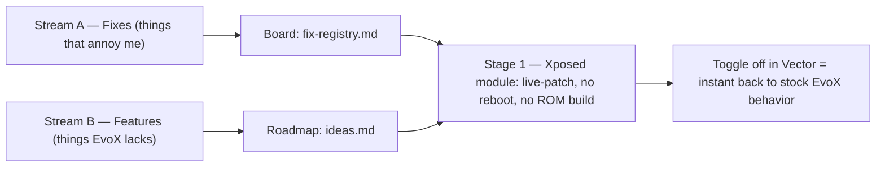

# EvoAtmo — my Evolution X workbench (Nothing Phone 2 — `Pong`)

A personal Evolution X customization repo for the Nothing Phone (2) (`Pong`), organized as **two work streams**:

- **Stream A — Fixes:** things in Evolution X that annoy me — captured, reproduced, and patched from my end (framework / SystemUI / Evolver / apps), each with its own evidence and patch folder.
- **Stream B — Features:** things Evolution X **doesn't have** — the flagship is the Nothing OS–style **Atmosphere unlock effect** (animated Gaussian blur + AGSL color-mesh wallpaper morph), an Xposed (Vector) module first, an Evolution X `frameworks/base` integration second. More ideas in the roadmap.

**The everyday lane is Stage 1 (Xposed).** You never build a ROM, never flash anything, and never reboot per change: each idea and fix is designed, tested, and iterated in the hot-reload loop (build the module → install it → restart SystemUI — seconds, not minutes). Stage 2/3 (source edits, a rebuilt SystemUI overlay) exists in the docs as the *later, optional* ladder — deliberately deferred.



The phone is rooted; every deploy path is **systemless** — partitions are never written, so Stream A/B work cannot brick the device (worst realistic case: a SystemUI crash-loop, which the rescue kit in [`operations.md`](operations.md) §1/§6 ends in under a minute). Structure, pipelines and languages: [`architecture.md`](architecture.md).

| Field | Value |
| --- | --- |
| Device | Nothing Phone (2) — `Pong`, SM8475, 120 Hz LTPO |
| ROM | Evolution X, Android 16+ (branches: `frameworks_base` `cnb`, device tree `bka`) |
| Runtime | Vector (JingMatrix) or LSPosed_mod + YukiHookAPI 1.2.1 |
| Status | Research / spec phase — no code committed yet; boards + docs ready |

## Documentation map

Read in this order the first time:

| # | Document | What it answers |
| - | -------- | --------------- |
| 1 | [`basics.md`](basics.md) | *How do the pieces work?* Plain-English concepts: the unlock pipeline, Android rendering APIs, SystemUI's lock-screen & wallpaper internals, the Xposed layer |
| 2 | [`engineering_specification.md`](engineering_specification.md) | *What exactly do we build?* Atmosphere's technical source of truth: verified hook matrix (V1–V12), engine + hook code, Stage 1→2→3 integration, risk register R1–R12 |
| 3 | [`architecture.md`](architecture.md) | *How do we structure & run the project?* Two streams (fixes + features), monorepo layout, component architecture, language inventory (Kotlin / Java / Rust / …), workflow rituals |
| 4 | [`setup.md`](setup.md) | *How do I set it all up?* Workstation tools, device prep, Vector + root manager, the Stage-1 module project, the AOSP workspace for Stage 2/3 |
| 5 | [`operations.md`](operations.md) | *How do I use it day to day?* The safety shield, hot-reload loop, testing checklist, failure playbook, command cheat sheet |
| 6 | [`ideas.md`](ideas.md) | *Features to add* (Stream B). Tiered roadmap T0–T3: preference panel, haptics, depth asset picker, frame watchdog, upstream PR, segmentation moonshot |
| 7 | [`fix-registry.md`](fix-registry.md) | *Things to fix* (Stream A). Every EvoX annoyance gets a row the moment it happens, then becomes `fixes/FIX-NNN-…/` |

## Quickstart

1. **Safety first** — run the pre-flight ritual in [`operations.md`](operations.md) §1 (armed disabler in a terminal *before* touching SystemUI).
2. **Understand the two streams** — read [`architecture.md`](architecture.md): fixes live in `fix-registry.md`, features in [`ideas.md`](ideas.md), both converge on the same Stage 1→2→3 deploy paths.
3. **Set up the environment** — follow [`setup.md`](setup.md) to the end of §5 (first Stage-1 smoke test).
4. **Daily loop** — build → install → restart SystemUI per [`operations.md`](operations.md) §2 and keep [`engineering_specification.md`](engineering_specification.md) open for the code. **Annoyed by something?** Row first in [`fix-registry.md`](fix-registry.md), fix later.

The spec's §2.3 and Appendix C are the *verify-first* habit: after every ROM update, re-check hook names against your tree before assuming anything still exists.

## Repo name — recommendation

Checked on **2026-10-24** via the GitHub search API (`in:name` query, 0 hits = name free):

| Candidate | Status | Verdict |
| --------- | ------ | ------- |
| **`evoatmo`** | ✅ 0 hits | **Recommended.** Short, brandable, matches the engine's log tag `EvoAtmo` (so logcat greps and repo branding align). Matches the `evo-atmo` tags used across these docs |
| `pong-atmosphere` | ✅ 0 hits | Runner-up: device-first, self-explanatory |
| `pong-atmosphere-engine` | ✅ 0 hits | Runner-up: most descriptive, good for searchability |
| `nothing-atmosphere` | ❌ taken | Avoid — occupied by `sepehrsamavati/nothing-atmosphere-effect`, an existing Nothing-style wallpaper-effects project |

This repo holds both the code and this documentation suite — scaffold + Stage-1 module project committed 2026-10-24 (`9df8fb6`) — and is published under the recommended name `evoatmo`.

## Repo layout

Code and documentation both live here:

```
evoatmo/
├── docs/                    ← this suite: README · architecture · engineering_specification · guides · fix-registry
├── features/
│   └── atmosphere-unlock/   ← flagship feature (engine/ · module/ · systemui/ · evolver/ · overlay/)
├── fixes/                   ← FIX-NNN-<slug>/ finding folders (board: docs/fix-registry.md)
├── assets/qa/               ← dumper outputs & per-build-ID QA artifacts
├── tools/{sh,py,rs}/        ← host-side tooling
├── research/                ← feasibility memos & scratch studies
└── flake.nix                ← Nix dev shell (JDK 17 · Android SDK 36 · Gradle · scrcpy)
```

## Note on front matter

All `.md` files carry front matter (`id`, `aliases`, `tags`); cross-links are relative
Markdown links, so they work identically on GitHub and in any Markdown-based notes tool.
