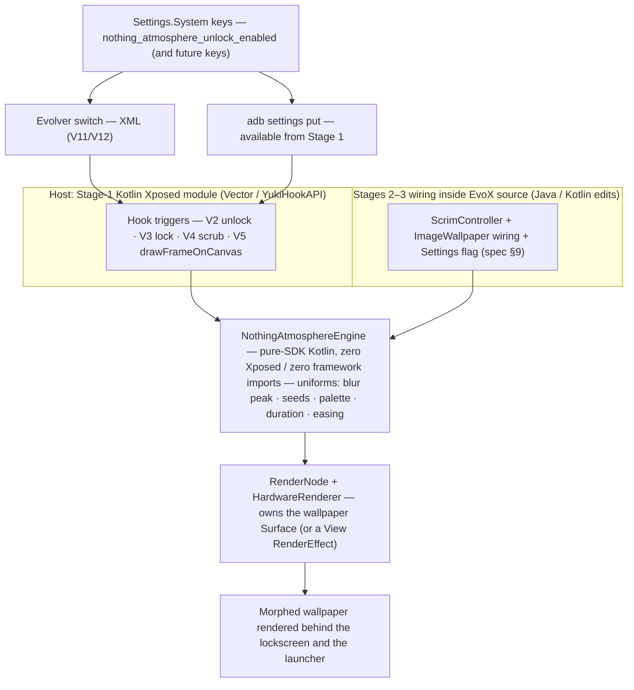
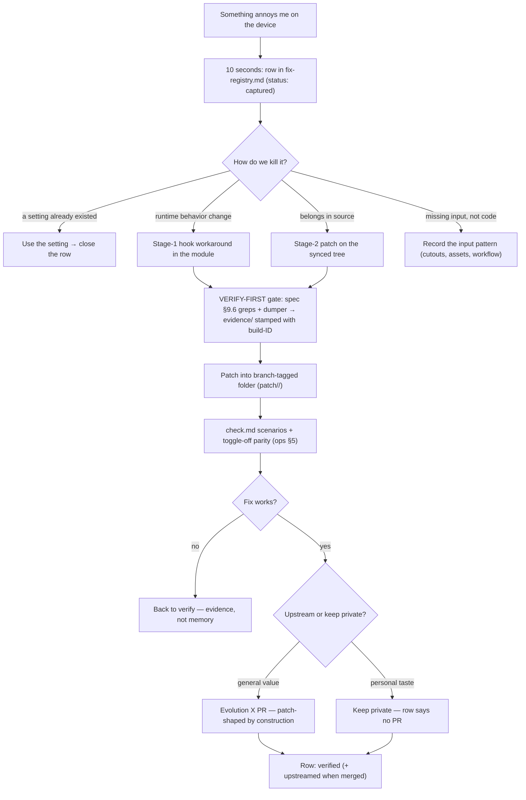
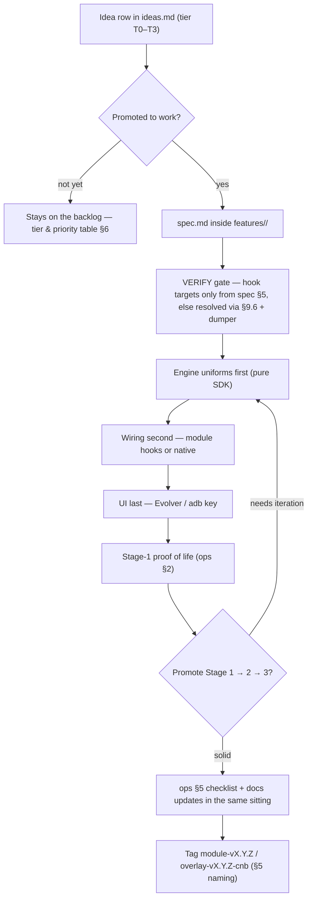
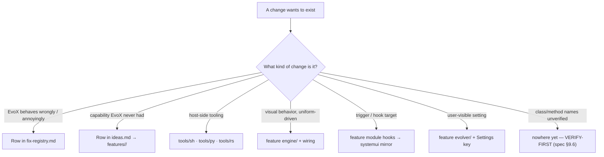

# EvoAtmo — Monorepo Structure & Architecture

*How this repo is organized, how work flows through it, and which languages we use where.*

**What this repo really is:** a personal customization workbench for **Evolution X on my Nothing Phone (2) (`Pong`)**. It holds two kinds of work:

- **Stream A — Fixes.** Things in Evolution X that *annoy me*. I find them, reproduce them, and patch them from my end (framework, SystemUI, Evolver, apps, device-tree behavior).
- **Stream B — Features.** Things Evolution X **doesn't have at all** (the Nothing-style Atmosphere unlock effect is the flagship; more from [`ideas.md`](ideas.md)).

Both streams share the same deployment mechanics (spec §8–§11: Xposed Stage-1 prototype → Stage-2 source patch → Stage-3 systemless overlay / my own ROM) and the same safety rules. This is a living document: **when adding any feature or directory that isn't listed here, either it fits an existing slot or this doc gets updated in the same commit.**

| Docs map (all relative to this folder) | What it holds |
| --- | --- |
| [`README.md`](README.md) | Project index + repo-name rationale |
| [`engineering_specification.md`](engineering_specification.md) | Atmosphere feature spec — technical source of truth (hooks V1–V12, engine, stages, risks) |
| [`basics.md`](basics.md) | Plain-English concepts |
| [`setup.md`](setup.md) | Environment, device prep, module project, AOSP workspace |
| [`operations.md`](operations.md) | Daily loop, safety shield, testing, rescue |
| [`ideas.md`](ideas.md) | Stream-B backlog: features EvoX doesn't have (T0–T3) |
| [`fix-registry.md`](fix-registry.md) | Stream-A board: everything that annoys me in EvoX, triaged |
| `architecture.md` *(this file)* | Repo structure, pipelines, languages, workflow |

---

## 1. Where the project lives

| What | Where | Holds |
| --- | --- | --- |
| **Documentation** | `docs/` (this repo) | The full suite — specification, plain-English guides, Stream-A board. |
| **Code & evidence** | repo root | `features/`, `fixes/`, `assets/qa/`, `tools/`, `research/` — created 2026-10-24 (commit `9df8fb6`) with the Stage-1 module Gradle project. |

> **Decision (2026-10-24):** documentation, boards, research, and code all live **in this repo**; the repo files are authoritative.

Repo-name note: `evoatmo` anchors on the flagship feature, but the repo scope is the **whole** personal EvoX workbench (fixes + features). That's fine — the brand follows the flagship; the architecture doesn't care.

**Rule:** exactly **one** authoritative copy of every file, in this repo — `docs/` for documentation, stream folders for code, per-finding folders for evidence. `engineering_specification.md` is authoritative for Atmosphere technical facts; per-finding/per-feature notes are authoritative for their own items.

---

## 2. The two streams and how each plugs into Evolution X

Everything we do ultimately becomes one of three *deployable forms* — no matter which stream it came from:

| Form | What it is | Blast radius | Permanence |
| --- | --- | --- | --- |
| **Stage 1 — Xposed live-patch** | Kotlin/Vector module hot-patching the running SystemUI process | None persistent | Until ROM update / unhook |
| **Stage 2 — source patch** | Editing EvoX sources on my synced tree, building `m SystemUI` (or other targets) | Reboot-level | Lives in my branch history; must be re-tilled on branch changes |
| **Stage 3 — packaged output** | Systemless overlay module of my rebuilt APK, or feature-merged into my own ROM zip | Boot-recoverable | Mine forever (my keys) |

**The everyday lane is Stage 1; Stage 2/3 is optional and later.** No ROM builds, no image flashing, no reboot per change. The Stage-1 hot-reload loop (ops §2) is how *every* idea and fix gets designed, tested, and iterated. Stage 2 (framework edits on my synced tree) and Stage 3 (shipping my remade SystemUI as a systemless overlay) are only unlocked when a Stage-1-proven feature has earned source integration — gated by ops §3 re-verification and the §4 signing rules before anything they produce touches the device.

### How any piece of work plugs into the device



**Component responsibilities** (dependency rule: hooks/native wiring → engine → nothing; the engine never learns about its host):

| Component | Language | Lives in | Owns | Must never |
| --- | --- | --- | --- | --- |
| Engine (`NothingAtmosphereEngine`) | Kotlin | feature `engine/` | Blur ramp, AGSL mesh, seeds, palette, settle/auto-tune, screen-off teardown | Import Xposed/framework classes; write disk; touch Monet |
| Stage-1 hooks (`HookEntry` + dumper) | Kotlin (YukiHook) | feature `module/` | Trigger wiring (V2/V3/V4/V5), scope, settings-key read | Crash on member rename (fail-open rule) |
| Stage-2/3 native wiring | Java (+Kotlin additions) | feature `systemui/` | Same calls in-tree; `Settings.java` flag | New lifecycle paths (reuse existing callbacks only) |
| Stage-3 overlay template | Shell + XML | feature `overlay/` | Packaging/signing the rebuilt SystemUI | Unsigned overlays; overlays onto CI-signed ROMs (R1) |
| Evolver UI | Java + XML | feature `evolver/` | Switches/sliders writing `Settings.System` keys | Anything beyond pref plumbing |
| Host tooling | Python / Rust / Shell | `tools/` | Log triage, asset prep, APK diffing | Depend on a device at runtime (host-side only) |
| Fix findings | text + diffs | `fixes/FIX-NNN-…/` | Evidence, patch, check scenarios, status | Skip the evidence step |

### Stream A — Fixes (things that annoy me in EvoX)

Lifecycle: **capture → triage → reproduce → verify (source truth) → choose form → patch → test → decide upstream vs keep**.



1. **Capture.** The moment something annoys me, it gets a row in [`fix-registry.md`](fix-registry.md) — symptom, one-line, component *guess* ( FIX/…/…). Do not trust memory; the registry exists so a "ugh, this again" moment in the evening costs 10 seconds.
2. **Triage.** Classify how to *kill* it:
   - **Stage-1 workaround** — can a hook change the behavior at runtime? (fastest kill, zero build, an Xposed module can also *fix* behavior, not just add features)
   - **Stage-2 patch** — behavior belongs in source (framework/Evolver/app/XML); patch on my synced tree
   - **Config/Evolver-level** — the thing already exists upstream and I was just missing a setting; cheapest of all, close the row
   - **Upstream-bug** → also file a note for an Evolution X PR (choose per §6 policy)
3. **Reproduce + verify.** Evidence before code: screenshots/screen-recording, `logcat`, then the verify habit — spec §9.6 greps + runtime `dumpMembers` dumps stored in the finding's `evidence/` (and the build-ID stamped).
4. **Patch.** All patch artifacts live in the finding folder, branch-tagged (`patch/cnb/…`). Patches must be *additive and minimal* — style follows the neighbors, `@string` resources in XML, commit messages explaining the callback reused (the same hygiene a future PR would need).
5. **Test.** Scenario rows in the finding's `check.md` + the ritual from [`operations.md`](operations.md) §5 where applicable (boot, AOD, toggle-off parity…).
6. **Archive or upstream.** Row marked `patched` / `upstreamed`; if upstreamed, link the PR in the finding note. After every ROM update: registry rows get re-run checks against the new build and any stale ones are marked `stale` with evidence.

### Stream B — Features (things EvoX doesn't have)

Lifecycle: **idea (registered in [`ideas.md`](ideas.md)) → mini-spec → VERIFY-first → engine/prototype → port → package → release**.



1. **Idea gating.** Any feature idea first becomes a row in [`ideas.md`](ideas.md) with a tier (T0–T3) and its hook targets (only spec §5 V-numbers or `[VERIFY: …]`).
2. **Mini-spec.** When promoted to work: a `spec.md` inside the feature folder (the Atmosphere flagship's full spec sits at the repo root until a second feature exists — then it moves into `features/atmosphere-unlock/`).
3. **Build order follows the spec §6 principles**: engine first (pure-SDK, uniforms), wiring second (hooks or native), UI last (Evolver/adb keys).
4. **Promotion path** Stage 1 → 2 → 3 exactly as spec §8/§9/§11; Stage-1 proof of life is mandatory before any Stage-2 source work.
5. **Test + docs update in the same sitting** (checklist extension in ops §5; spec Appendix B entry for any contract change).

### The shared invariant (stream-independent)

> Engine stays pure-SDK Kotlin, wiring distinguishes host, patches stay minimal/additive, patches are branch-tagged and re-verified after every OTA, and *nothing* ships without a toggle-able `Settings.System` key.

---

## 3. Monorepo layout

Slots are created **when first needed** — nothing pre-created beyond what exists:

```
evoatmo/                                ← this folder = repo root
├── README.md
├── architecture.md                     ← this doc
├── engineering_specification.md        ← Atmosphere flagship spec (moves to its
│                                         feature folder when feature #2 exists)
├── docs/
│   ├── basics.md  setup.md  operations.md  ideas.md
├── fixes/                              ← STREAM A — annoyances in EvoX
│   ├── _registry.md                    ← the triage board (capture the pain here)
│   └── FIX-NNN-<slug>/                 ← one folder per triaged finding
│       ├── note.md                     ← symptom / repro / root-cause / chosen form
│       ├── evidence/                   ← logcat, dumps, greps, recordings (build-ID stamped)
│       ├── check.md                    ← how we know it's fixed + regression notes
│       └── patch/                      ← diffs or whole files, per branch (cnb/, bka/…)
├── features/                           ← STREAM B — capabilities EvoX lacks
│   └── atmosphere-unlock/              ← flagship feature folder (setup when Stage 1 starts)
│       ├── note.md                     ← status, promotion-stage checklist, key links
│       ├── engine/                     ← canonical engine copy (spec §7)
│       ├── module/                     ← Stage-1 module project (Gradle, §8)
│       ├── systemui/                   ← Stage-2/3 patch workbench (per branch)
│       ├── evolver/                    ← UI snippets (§9.5)
│       ├── overlay/                    ← Stage-3 module template + sign script (§11)
│       └── assets/qa/<buildID>/        ← dumps & test evidence per ROM build
├── assets/                             ← shared fixtures: test wallpapers, palettes, cutouts
├── tools/
│   ├── sh/                             ← adb rituals promoted from ops cheat sheet
│   ├── py/                             ← dumper-diff, log triage, cutout batch, Perfetto crunch
│   └── rs/                             ← optional Rust CLIs (§5.3)
└── research/                           ← evidence trail: clippings, experiments, decisions
```

What does **not** belong here: AOSP/EvoX source trees (they live in the Linux build workspace), device-tree clones, build outputs (`out/`, `app/build/` — gitignore), anything from other projects.

**Placement decision table** (where a change lands):

| If the change is… | It goes to… |
| --- | --- |
| "X annoys me / behaves wrong" | `fix-registry.md` first, then `fixes/FIX-NNN-…/` |
| A capability EvoX has never had | `ideas.md` row → later `features/<slug>/` |
| New visual behaviour driven by uniforms | feature folder `engine/` (+ wiring) |
| A trigger/hook target change | feature `module/` hooks, mirrored into `systemui/` |
| A new user setting | Evolver XML + key list (feature `evolver/`; native spec §9.2 rule) |
| Log/asset/tooling need | `tools/` |
| Dumper output / symbol evidence | finding or feature `assets/qa/<buildID>/` |
| Unverified class/method names | **nowhere yet** — VERIFY-FIRST (spec §9.6) first |

The same routing as a flowchart:



---

## 4. Languages (what we write in, and why)

### 4.1 Required — the critical path

| Language | Where it's used | Why it's required |
| --- | --- | --- |
| **Kotlin** | Engines, Stage-1 module code, most new code, build scripts | Pure-SDK engine design; YukiHook is a Kotlin DSL; one engine copy compiles for module *and* frameworks integration |
| **Java** | Stage-2/3 patch points (`ScrimController.java`, `ImageWallpaper.java`, `Settings.java`), Evolver classes | The EvoX/SystemUI code we patch on those branches is Java — patches must speak to it in-situ; keep the Java surface additive and minimal |
| **AGSL** (SkSL dialect) | `RuntimeShader` sources inside engines | The mesh shader is AGSL by design (R5 degrade path); half/float typing discipline applies |
| **XML** | Evolver prefs, overlay layouts, `module.prop`, manifests | Android's resource/preference format; the toggle plumbing lives here |

### 4.2 Supporting

| Language | Where | Why |
| --- | --- | --- |
| **Bash/shell** | Every adb ritual, `tools/sh/`, Stage-3 packaging scripts | adb *is* the device interface; one-liners graduate into scripts |
| **Gradle KTS** | `module/build.gradle.kts`, version catalogues | Build config is code (spec §8.1 block is KTS) |
| **Python** | `tools/py/` | Fastest throwaway analysis: dumper-diff reports, cutout batch prep, Perfetto frame stats |

### 4.3 Optional — deliberately scoped

| Language | Scope limit (honest) |
| --- | --- |
| **Rust** | `tools/rs/` standalone CLIs only — e.g. hook-drift checker (diff two dumps → report renamed members), APK/zip inspector for verifying signed overlays before flashing, log triage. **Not** for the Stage-1 module or Stage-2 wiring: Xposed modules run as JVM bytecode in SystemUI's process and the EvoX paths we touch are Java/Kotlin. Rust-in-AOSP exists, but that path here is a moonshot, never the default |
| **C / C++** | Read-mostly: device-tree HAL code (`vibrator/`, `nothing-fwk` stubs) if a fix or haptics idea ends up there. VERIFY-FIRST before writing anything |

**Engine-language red line:** keep each feature's engine pure-SDK Kotlin across all stages; capabilities reach it via uniforms + host wiring. If a feature can't fit that shape, amend the spec (Appendix B) first.

---

## 5. How we work (solo, trunk-based, verify-first)

1. **Work is picked from the two boards** — [`fix-registry.md`](fix-registry.md) (Stream A) or [`ideas.md`](ideas.md) (Stream B). Anything new gets a row on its board *before* code.
2. **VERIFY gate** — spec §9.6 greps + runtime dumper for anything outside spec §5; evidence goes in the finding/feature folder with the build-ID.
3. **Branching** — `main` is always installable. Feature branches for Stage-2/3 work: `feat/<slug>` (features), `fix/<id>-<slug>` (fixes).
4. **Engine/wiring order** never flips; Stage-1 proof of life precedes native work.
5. **Testing** — ops §5 checklist + per-item `check.md`; Perfetto trace for transition changes; toggle-off parity always checked.
6. **Docs in the same sitting** — spec/Appendix B (contracts), boards (status), this doc (new slots), ops §5 (new scenarios).
7. **Safety non-negotiable** — the pre-flight ritual ([`operations.md`](operations.md) §1) before any SystemUI-touching session.

### What gets updated when (doc-sync matrix)

| If a change touches… | Update — in the same sitting… | Because |
| --- | --- | --- |
| Engine behavior / uniform defaults | spec §7 + the feature `note.md` | the engine contract lives in the spec |
| Hook targets / trigger names | spec §5 + dumper evidence in the QA folder | anchors are the source of truth |
| A `Settings.System` key / toggle | spec §9.2-style key list + an ops §5 scenario | testability + Evolver parity |
| Repo layout (new slot/directory) | this doc §3 **and** `README.md` layout tree | the "fits a slot or update the doc" rule |
| Deploy / packaging steps | ops §4 / §7 | commands drift silently |
| A fix shipped | its registry row + `note.md`/`check.md` | Stream-A evidence trail |
| An upstream PR merged | the point-of-origin row (+ PR link); local patch stays until the released build ships it | fallback keeps the phone behaving |

### Naming & versioning

| Artifact | Convention |
| --- | --- |
| Fix findings | folder + ID `FIX-001-…` (ids never reused; statuses tracked on the board) |
| Feature branches/tasks | `feat/<tier>-<slug>` (e.g. `feat/t1-haptics`) |
| Module releases | tag `module-v0.1.0`, semver, APK on the GitHub release |
| Overlay releases | tag `overlay-v0.1.0-<branch>` (branch = ROM build-line, `cnb`) |
| QA snapshots | `<…>/assets/qa/<BUILDID>/<date>/<name>` (build-ID first two letters per spec §2.3) |
| Upstream PRs | branch `patchoup/<topic>`; fix or feature note links the PR after submit |

---

## 6. Upstream policy (what leaves this repo)

- **Upstream PR** for fixes/features that have general value to EvoX and survive review hygiene: minimal diffs, existing-code style, `@string` resources, test evidence attached, one concern per PR. The Stream-A pipeline produces PR-shaped patches by construction.
- **Keep private** when a change is personal taste (nothing wrong with taste — taste just doesn't go into a shared repo).
- Every PR is recorded with its link on the originating board row; a merged PR never changes `main` here until the released EvoX build actually ships the change — the local patch is the fallback that keeps the phone behaving.

---

## 7. Doc conventions in this project

- Front matter on every file: unique `id:`, `aliases:`, `tags:` beginning with `evo-atmo`.
- The `.md` docs at root + `docs/` are the durable map; `research/` and per-finding notes carry the evidence trail. One decision per note in `research/`.
- Relative Markdown links everywhere (render identically on GitHub and in any Markdown editor). Wikilinks are fine for personal scratch notes, but files must not *depend* on them.
- Adding a doc? Register it in this file's map table **and** `README.md`, then commit both.

---

## 8. Pointers

- Atmosphere feasibility, hooks, engine code, risks: [`engineering_specification.md`](engineering_specification.md)
- Getting running: [`setup.md`](setup.md) — staying running: [`operations.md`](operations.md)
- Stream B backlog: [`ideas.md`](ideas.md) — Stream A board: [`fix-registry.md`](fix-registry.md)
- New here? Start: `README.md` → `basics.md` → spec.
