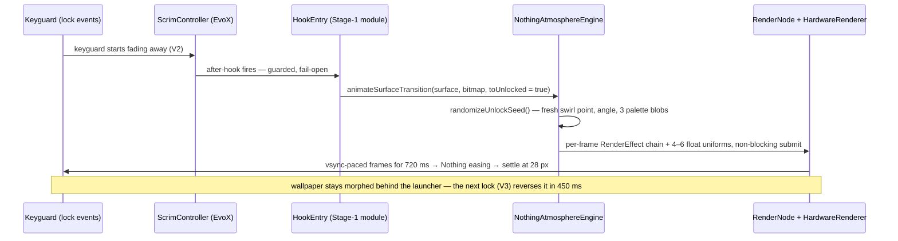

# Concepts: how all the pieces actually work

A plain-English tour of the Nothing OS "Atmosphere" Unlock Engine for Evolution X on the Nothing
Phone (2) (`Pong`): an Xposed (Vector) module plus an Android framework mod that layers an animated
Gaussian blur and an AGSL color-mesh morph over the wallpaper on every unlock — and keeps the
wallpaper visually morphed on the home screen until the next lock. The engineering specification is
the source of truth; labels like **V2 / V3 / V5** below point at its verified hook-point matrix
(spec §5), confirmed against the actual Evolution X source (`frameworks_base`, branch `cnb`).

## 0. The Whole Picture

```
      ONE UNLOCK, END TO END   (Surface / morph mode — the shipped behavior)

    fingerprint · PIN · swipe
             │  keyguard dismissal begins
             ▼
 ┌───────────────────────────────────────────────────────────────────────────┐
 │  VERIFIED TRIGGER & HOOK POINTS (spec §5)                                │
 │   V2  ScrimController.onKeyguardFadingAwayChanged()                      │
 │       unlock trigger → the morph runs 0 → 1                              │
 │   V3  ScrimController.onKeyguardVisibilityChanged(boolean)               │
 │       lock trigger → the morph runs back 1 → 0                           │
 │   V5  ImageWallpaper$CanvasEngine.drawFrameOnCanvas(Bitmap)              │
 │       surface ownership → while enabled, the engine draws the wallpaper  │
 └─────────────────────────────────────┬─────────────────────────────────────┘
                                       │  hooks fire, guarded + fail-open
                                       ▼
 ┌───────────────────────────────────────────────────────────────────────────┐
 │  NothingAtmosphereEngine                                                 │
 │  randomizeUnlockSeed()          a fresh seed for THIS unlock             │
 │  ValueAnimator 0 → 1           720 ms on the Nothing easing curve        │
 │  every animation frame:                                                  │
 │    · build the RenderEffect chain for this fraction                      │
 │    · node.setRenderEffect(chain)                                         │
 │    · write 4–6 float uniforms on the RuntimeShader                       │
 │    · HardwareRenderer: setWaitForPresent(false).syncAndDraw()            │
 │      (non-blocking, VSYNC-paced submit)                                  │
 └─────────────────────────────────────┬─────────────────────────────────────┘
                                       ▼
 ┌───────────────────────────────────────────────────────────────────────────┐
 │  GPU  —  HardwareRenderer + RenderNode                                   │
 │  · bitmap recorded into the display list ONCE per bind                   │
 │  · RenderEffect chain on the recorded node:                              │
 │      Gaussian blur (peak 110 px → settled 28 px)                         │
 │      ⊕ AGSL RuntimeShader: UV swirl · sine warp · saturation boost       │
 │        · 3-blob color mesh from WallpaperColors                          │
 └─────────────────────────────────────┬─────────────────────────────────────┘
                                       ▼
        the morphed wallpaper is rendered to the live Surface, BEHIND the
        lockscreen AND the launcher → the settled morphed home screen stays
        until the next lock (then V3 reverses it, 450 ms)
```

**Why Stage 1 is the safe lane.** None of this touches the ROM on disk. The module exists only inside Vector's Xposed layer, hooks existing methods at runtime, and switching it off hands every code path straight back to the stock EvoX classes. No flashing, no slot switching, no reboot per change — the hot loop in [`operations.md`](operations.md) §2 does build → install → restart SystemUI in seconds. The staged ladder described later exists only as the *later, optional* way to ship the same verified behavior in-tree.

**The same unlock cycle, as a sequence diagram:**



**Locked and idle.** While the phone is locked, the engine sits at fraction 0 and the wallpaper
behind the lockscreen is pixel-sharp. On the Surface path the engine refuses GPU work when both
the incoming and stored fraction are zero (an early return in `renderFrame`), so the locked state
re-renders nothing on its own — the only recurring idle cost is the settled home-screen state.

**The transition.** On unlock, the verified V2 callback fires as the keyguard begins fading away;
the toggle is read and the engine randomizes its seed — the swirl center jumps to a fresh random
point, a new swirl angle is picked, and three new mesh blobs are drawn from the wallpaper's
palette. A 720 ms animation then walks 0 → 1 (≈86 frames at 120 Hz), each frame rebuilding only the
effect for the new fraction, setting it on the node, and writing 4–6 float uniforms before a
non-blocking submit — the bitmap was recorded into the display list once at bind.

**The settle.** The effect then swaps to its "settled" variant — same look, blur radius down from
the 110 px peak to 28 px — and one blocking draw measures the present time; if that exceeds 22 ms,
the peak radius is cut by 40% (floor 55 px), tuned across successive unlocks until it fits the
budget. From then on the home screen keeps showing the morphed wallpaper. Nothing is stored: the
persistence *is* the settled RenderEffect on the live wallpaper Surface until something animates it.

**Reversal and teardown.** Locking runs the mirror animation, 1 → 0 over 450 ms (V3, fired when
keyguard becomes visible again), landing on the sharp wallpaper behind the lockscreen. On screen
off (power button, AOD), the module's `ACTION_SCREEN_OFF` receiver calls `setScreenActive(false)`,
destroying the `HardwareRenderer` and freeing GPU resources (risk R8 — no wasted rendering while
invisible); everything rebinds lazily on the next frame, so lock/unlock cycles never accumulate
state.

## 1. Android Rendering, in Plain Words

The engine deliberately builds on a small set of public Android APIs (API levels from the spec's
architecture principles, §6.2; all available on this ROM's Android 16+ base).

### Surface

A `Surface` is a pixel buffer the system hands to a component to draw into; the wallpaper engine
gets one, and the hook code reaches it through the public `surfaceHolder` API (no reflection).
The engine binds its `HardwareRenderer` to it and renders every morph frame there. Chosen because
the Surface is the layer visible behind *both* the lockscreen and the launcher — that's what makes
the "stays morphed" behavior free. Corollary: one producer per Surface (spec principle 3, risk
R3) — stock `lockHardwareCanvas` or our renderer, never both.

### View / RenderNode (API 29)

A `RenderNode` is a lightweight display-list container: you record drawing operations into it once,
and the GPU can replay, transform, and apply effects to it cheaply. The engine uses nodes two ways:
"View mode" attaches an effect chain onto an existing View (SystemUI's background scrim, for quick
prototyping), and "Surface mode" creates one node (`AtmosphereWallpaperNode`) as the content root
of the `HardwareRenderer`. Chosen because changing what a node *does* (`setRenderEffect`) never
requires re-recording what's *inside* it — that is the core of the zero-allocation animation loop.

### RenderEffect (API 31)

`RenderEffect` is a GPU effect attached to a View or node: the engine uses `createBlurEffect` for
Gaussian blur, `createRuntimeShaderEffect` to run its AGSL shader, and `createChainEffect` to
compose the two (shader inner, blur outer). Chosen because effects execute entirely on the GPU —
no per-pixel loops, no offscreen bitmap copies (spec §14) — in one attached effect. If AGSL is
unavailable on the device's driver, the chain degrades to a slightly stronger blur (radius × 1.05)
instead of losing the transition (risk R5 fallback).

### RuntimeShader / AGSL (API 33)

A `RuntimeShader` is a small GPU program compiled once, then re-run per pixel every frame with new
uniform values. The engine's shader (spec §7) does the swirl, displacement, saturation boost, and
color mesh — all driven by those uniforms. Compilation is guarded by a `try/catch` (a vendor-driver
failure downgrades the engine to blur-only — logged "AGSL compile failed", risk R5), math kept in
`half` types for driver acceptance; per-unlock variety costs a few floats, not a recompile.

### HardwareRenderer + RenderRequest (`syncAndDraw`, `setWaitForPresent(false)`)

`HardwareRenderer` draws a RenderNode tree into a bound Surface and persists across frames —
created at bind time, reused until teardown. Per frame the engine calls
`createRenderRequest().setWaitForPresent(false).syncAndDraw()`: a non-blocking submit paced with
the display's refresh signal (the spec calls this VSYNC-paced, 120 Hz friendly). The blocking
variant (`setWaitForPresent(true)`) is used exactly once per unlock — the auto-tune measurement.
Chosen because a persistent renderer plus fire-and-forget submits means zero per-frame allocation.

### Canvas recording (display list recorded once)

At bind time the engine records the wallpaper bitmap into the node's display list exactly once
(`node.beginRecording` → one `drawBitmap` → `endRecording`). After that, per-frame CPU work is only
the uniform writes, the `setRenderEffect` call, and the submit — the display list is never
re-recorded unless the surface or size changes. Chosen because recording is the expensive step;
doing it once per bind is what makes an 86-frame transition at 120 Hz affordable.

| Building block | API | Role in the engine | Why it was chosen |
| --- | --- | --- | --- |
| `Surface` | — | the wallpaper's pixel window | visible behind lockscreen + launcher; enables visual-only persistence |
| `RenderNode` | 29 | holds the recorded bitmap + current effect | swap effects without re-recording contents |
| `RenderEffect` | 31 | blur ⊕ shader chain | pure-GPU composition, no bitmap copies |
| `RuntimeShader` (AGSL) | 33 | swirl / warp / saturation / mesh | variation via uniforms, never a recompile |
| `HardwareRenderer` + request | 29 | draws node tree to the Surface | persistent, non-blocking, VSYNC-paced submit |
| Canvas recording | — | bitmap → display list once | the expensive step happens once per bind |

## 2. SystemUI's Lockscreen & Wallpaper Pipeline

Everything the engine touches lives inside SystemUI. Three areas matter.

**The wallpaper layer.** The wallpaper is drawn by SystemUI's own `ImageWallpaper$CanvasEngine`,
serving the picture behind *both* the lockscreen and the launcher — an effect applied to that one
Surface shows in both places without touching either consumer. The verified draw entry point is
`drawFrameOnCanvas(Bitmap)` (V5), with internal chain
`drawFrame / drawFrameSynchronized / drawFrameInternal` (V6) that must not run concurrently with
ours. The stock file draws via `surface.lockHardwareCanvas()` and has no
`RenderEffect`/`HardwareRenderer` today (V7): when the toggle is on, our renderer *becomes* the
producer; when off, the stock path runs untouched (spec §9.4).

**The scrim layer.** `ScrimController` owns the dimming scrims during lock-state transitions —
`mScrimBehind` is the scrim behind the keyguard: the blur/morph target in Scrim-mode, referenced
57–59 times in the file (spec V1). Inside it live the verified trigger callbacks:
`onKeyguardFadingAwayChanged()` (V2, morph 0 → 1), `onKeyguardVisibilityChanged(boolean)` (V3,
`onKeyguardVisibilityChanged(boolean)` (V3, morph 1 → 0), and
`setTransitionToFullShadeProgress(float, float)` (V4, continuous blur while scrubbing the shade).
View-mode prototyping pulses that scrim view directly; morph mode only uses ScrimController as the
trigger source.

**The lock-state event carriers.** `KeyguardViewMediator` and `KeyguardStateController` carry
lock-state events through SystemUI — and the cautionary fact is V9: **`KeyguardViewMediator
.onKeyguardGoingAway()` does not exist** (v1 relied on it; the real class only invokes
`onKeyguardGoingAwayRemoteAnimationStart/Cancelled` on other objects). That is why every trigger
was re-anchored onto the verified ScrimController callbacks plus `KeyguardStateController.Callback`
(V10 — `onKeyguardShowingChanged()` / `onKeyguardFadingAwayChanged()`), the preferred native anchor
for Stage 2; `doKeyguardLocked(Bundle)` (V8) is the documented backup lock trigger, always hooked
with explicit parameters. Lesson: hook names from the matrix, never from memory.

**The do-not-disturb rule for the wallpaper system.** The engine never calls
`WallpaperManager.setBitmap()` per unlock — v1's draft did, and it was removed deliberately
(Appendix B). Writing a new bitmap would wake the wallpaper system: Monet / `WallpaperColors`
recomputation (which must not be disturbed — an explicit non-goal), a jank/ANR-prone synchronous
write per unlock, and flash wear (risk R6). The morph is strictly visual: pixels on the live
Surface, disk image untouched, launcher and Monet seeing the same wallpaper as always — the "new
wallpaper every unlock" is produced entirely inside the GPU.

## 3. The Hooking Layer (Xposed → Vector → YukiHookAPI)

Runtime hooking changes a *running* app's behavior without modifying any file on disk. When the
target process starts — here, SystemUI — a module's code is injected into that process, where it
can wrap chosen methods so extra code runs after the original (an `after` hook) or the method is
replaced entirely (`replaceAny`). Nothing is permanent: restart the process and the injection
re-applies; remove the module and the app is fully stock again — hence Stage 1's five-second
iteration loop (install → `pkill com.android.systemui` → updated hooks), zero reboots.

The toolchain: **Vector (JingMatrix)** is the Xposed framework — the active successor of LSPosed,
supporting Android 8.1 → 17, with `mywalkb/LSPosed_mod` as fallback — and **YukiHookAPI 1.2.1**
(latest on Maven at verification) is the Kotlin wrapper, plus its KSP plugin, that turns raw
Xposed calls into readable, type-safe hooks. The module's scope is exactly one app,
`com.android.systemui` (optionally advertised via the `xposedscope` manifest meta-data), so no
other app can be affected by a mistake.

Every hook in the module follows three hard patterns from the spec:

1. **`firstMethodOrNull` + a logged NOT-FOUND.** Hooks are name-based, so every missing name logs
   a loud `... NOT FOUND — run dumpMembers` line instead of throwing — a ROM update that renames a
   method produces a logcat message, not a crash loop (risk R4).
2. **Fail-open.** Every hook body is wrapped in `try/catch`, falling back to `callOriginal()` — a
   broken effect degrades to stock behavior, never crashing SystemUI (spec principle 7; risk R2).
3. **The runtime member dumper.** `dumpMembers(className)` prints the real field/method names of
   *your ROM build* to logcat under the `EvoAtmo` tag — after an OTA, one read shows exactly what
   moved, paired with the spec's Appendix C greps for adaptation without guesswork.

Two structural constants: a single engine instance lives in a module field and is lazily created
(`engine ?: NothingAtmosphereEngine().also { engine = it }`) by every hook path, so all triggers
share one persistent GPU pipeline; and the engine class itself contains zero Xposed imports — the
identical source compiles both inside the module (Stage 1) and inside `frameworks_base` (Stage 2).

## 4. The Feature Itself

Walk the unlock with the numbers the engine actually uses.

| Moment | What happens |
| --- | --- |
| t = 0 | V2 fires → toggle checked → `randomizeUnlockSeed()`: new swirl center (0.2–0.8 in x/y), new swirl angle (±2.4 rad), three fresh blobs drawn from the wallpaper palette |
| 0 → 720 ms | fraction eases 0 → 1 on the Nothing curve; per frame: effect rebuilt for the fraction + 4–6 uniform writes + non-blocking submit; blur ramps toward the 110 px peak |
| t = 720 ms | settle: effect rebuilt with `settled = true` → 28 px; one *blocking* present-time measurement → auto-tune if cost exceeded the budget |
| unlocked | home screen shows the settled morph and keeps it — only re-rendered when the wallpaper engine itself redraws (negligible idle cost, spec §14) |
| lock | V3 (`visible = true`) → mirrored animation 1 → 0 over 450 ms → pixel-sharp wallpaper behind the lockscreen |
| screen off | `ACTION_SCREEN_OFF` → renderer released; clean rebind on the next visible frame |

**The Gaussian blur ramp.** The transition peaks at a 110 px blur radius and settles to a constant
28 px — an idle-cost guard against a maxed-out blur taxing GPU and battery (risk R7).

**The AGSL shader stages.** The shader program runs per pixel every frame, in this order:

1. **UV swirl** — sampling coordinates rotate around the random seed point; strength decays with
   distance (`exp(-2.2·dist)`) and scales with progress, strongest exactly at the seed.
2. **Low-frequency sine displacement** — x and y are pushed by slow waves (frequency 4.5,
   amplitude 0.14 × progress, phase from the seed × 2π), the soft "mesh diffusion" wobble; sample
   coordinates are clamped to 0.02–0.98 so sampling never leaves the image.
3. **Luminance-preserving saturation boost** — saturation grows to `1 + 0.42 × progress` while
   brightness (luma) is preserved; computed in half-precision for driver safety.
4. **WallpaperColors-driven 3-blob color mesh** — three soft Gaussian blobs tint the image with
   colors from the wallpaper's main `WallpaperColors` (fed once); positions (0.2–0.8) and radii
   (0.22–0.47) re-randomize every unlock. Mixing is capped (`0.55 × meshStrength × progress`);
   with fewer than three available colors the mesh is skipped.

The two effects are chained: the shader warps and tints first (inner), then the Gaussian blur
diffuses (outer) — swirl-into-diffuse is what makes the look organic rather than smeared. The swirl
center itself *glides* across the 720 ms from the old position to the new random one, so every
unlock is a different movement of the same surface.

**The easing curve.** Everything runs through `PathInterpolator(0.22, 1.0, 0.36, 1.0)` — fast
attack, long smooth deceleration — so the blur swells immediately on unlock and glides into place.
The same object drives the reversed 450 ms lock animation, keeping both directions consistent.

**The auto-tune.** Once per unlock, after the settle draw, the engine performs one *blocking*
present (`setWaitForPresent(true)`) and measures the wall-clock time; if it exceeds 22 ms, the
peak blur radius drops 40% (× 0.6, floor 55 px), re-applied over later unlocks until the
transition fits the device's budget. One measurement, one adjustment — never a background loop.

**The settings key.** `nothing_atmosphere_unlock_enabled` in `Settings.System` is read at runtime
on every hook invocation (default: enabled); Stage 1 already reads it, so the toggle works before
any framework source change — via `adb shell settings put system nothing_atmosphere_unlock_enabled
0|1`, or the Evolver switch once wired in Stage 2 (spec §9.5). Toggle it off and the hooks
short-circuit / call the original: stock behavior, no hook work at all (spec test 5).

## 5. Glossary

| Term | One-line definition |
| --- | --- |
| keyguard | The lockscreen state — the PIN/fingerprint/clock layer shown while the device is locked; its dismissal and visibility events are this project's triggers. |
| scrim | A dim/tint layer the system lays over the wallpaper; `mScrimBehind` is the one behind the keyguard. |
| ScrimController | SystemUI class owning the lockscreen scrims; also carries the verified V2/V3/V4 trigger callbacks. |
| SystemUI | The system app drawing the status bar, keyguard, and notifications — and, in this ROM, the wallpaper itself via `ImageWallpaper$CanvasEngine`. |
| system_ext | The system partition directory where modern SystemUI lives; the Stage-3 build outputs to `out/target/product/Pong/system_ext/priv-app/SystemUI/`. |
| privilege app | An app under `priv-app/` holding extra system permissions; SystemUI is one — which is why a replaced APK must carry the ROM's platform signature (risk R1). |
| Zygisk | The code-injection channel of modern root managers (Magisk; KernelSU/APatch paths, spec §3) that lets the Vector module load its code inside SystemUI's process. |
| Xposed module scope | The list of apps a module is allowed to hook; this project scopes itself to `com.android.systemui` only. |
| AGSL | The GPU shader language accepted by `RuntimeShader`; the morph program (swirl, warp, saturation, color mesh) is AGSL source text. |
| display list | The recorded sequence of GPU drawing commands; the wallpaper bitmap is recorded into one list once per surface bind, after which only uniforms change. |
| RenderNode | A display-list container that can also carry a `RenderEffect`; the engine's surface node is named `AtmosphereWallpaperNode`. |
| SurfaceFlinger | Generic Android background: the system compositor combining every app's Surface into the final frame; this project never talks to it — the engine only draws into the Surface it is handed. |
| binder | Generic Android background: the inter-process communication mechanism under every system-service call (the engine's `Settings` checks and `WallpaperManager` color fetch go through it). |
| OTA | An over-the-air OS update; each one can rename hooked members, so after every OTA re-run the spec's Appendix C greps plus the member-dumper log before touching code. |
| systemless overlay | A root-module tree under `/data/adb/modules/` that the boot process overlays onto the system without writing any partition; Stage 3 ships the rebuilt SystemUI this way (risk R10). |
| AOD | Always-On Display, the low-power locked screen; screen-off/AOD is where the engine frees its GPU resources (`setScreenActive(false)`, risk R8). |
| LTPO / 120 Hz | The Phone (2)'s adaptive display panel (spec §2.1); the transition budget is defined against it — 720 ms ≈ 86 frames (spec §14). |

**Where to go next**

- Architecture, exact hook signatures, and the full engine source: [`engineering_specification.md`](engineering_specification.md) (single source of truth).
- Getting the module and framework port running: [`setup.md`](./setup.md).
- Day-to-day care (toggles, log greps, recovery, surviving ROM updates): [`operations.md`](./operations.md).
