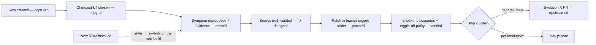

# EvoX Annoyance Registry (Stream A)

**The board for everything in Evolution X that annoys me** (Nothing Phone (2) `Pong`). Symptoms get captured here the moment they happen; they are turned into structured fixes later. Companion of the **feature** backlog ([`ideas.md`](ideas.md) — Stream B). Workflow, folder layout and language rules: [`architecture.md`](architecture.md) §2–§4.

## How to use — the 10-second habit

When something annoys you on the device, **append a row to the board below — do not fix, do not trust memory.** A capture costs 10 seconds; a re-discovered annoyance costs a whole evening. IDs increment and are never reused. Triage (how to kill it) happens later, calmly, using the lifecycle in `architecture.md` §2.

## Status legend

| Status | Meaning |
| --- | --- |
| `captured` | logged, nothing else done |
| `triaged` | cheapest kill chosen: setting / Stage-1 hook workaround / Stage-2 patch / upstream bug |
| `repro'd` | consistent reproduction steps recorded in `note.md`, evidence captured |
| `fix-designed` | source-truth verified (spec §9.6 greps + dumper), patch approach written |
| `patched` | fix built into a Stage-1 module change or Stage-2 source patch |
| `verified` | passes its `check.md` scenarios after a clean deploy |
| `upstreamed` | PR filed upstream (link in `note.md`); local patch remains the fallback |
| `stale` | a ROM/branch update invalidated the evidence or patch — needs re-verification |

### How a row moves through its statuses



## The board

| ID | What annoys me (symptom, one line) | Component guess | Cheapest kill? | Status | Build-ID last touched | Folder | Upstream PR |
| --- | --- | --- | --- | --- | --- | --- | --- |
| — | — | — | — | — | — | — | — |

*(Deliberately empty — the first real annoyance becomes `FIX-001` and gets a folder.)*

## Per-finding folder template (copy on triage)

```
fixes/FIX-NNN-<slug>/
├── note.md        ← symptom, repro steps, evidence links, root-cause hypothesis,
│                    chosen kill path, status history, regression watch
├── evidence/      ← logcat, dumps, greps, recordings — each stamped with the build-ID
├── check.md       ← "how I know it's fixed" scenarios + regression notes
└── patch/<branch> ← diffs or modified files, branch-named (cnb/, bka/…)
```

`note.md` skeleton (front matter like the rest of the suite):

```markdown
---
id: fix-NNN-slug
aliases: ["FIX-NNN — one-line symptom"]
tags: [android, rom, evo-atmo, fixes]
---
# FIX-NNN — <one-line symptom>

## Symptom
## Repro steps
## Evidence (links into evidence/; build-ID: CN…)
## Root-cause hypothesis
## Chosen kill path (setting / S1 hook / S2 patch)
## Status history (captured → triaged → … ; dates)
## Regression watch (what to re-check after ROM updates)
```

## Rules for every fix

1. **Evidence before code** — verify source truth first (spec §9.6 greps + runtime dumper from `operations.md` §3); dumps land in `evidence/`, never in memory.
2. **Minimal, additive patches** — branch-tagged folders; attribute style follows the neighbours; `@string` resources when the XML could go upstream (spec §9.5 hygiene).
3. **Toggle where possible** — a `Settings.System` key for the fixed behavior means toggle-off parity is testable exactly like ops §5 check 5, and turning it off costs one settings command.
4. **Re-run non-stale rows after every ROM update** — the same §3 routine that re-verifies Atmosphere hooks; stamp `Build-ID last touched` on the board or mark `stale`.
5. **Upstream decision is explicit** — `upstreamed` or `keep-private`, recorded on the row (upstream policy: `architecture.md` §6).
