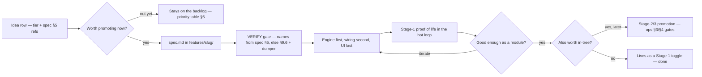

# Feature Ideas & Roadmap — What Else You Can Do

A ladder of ambition for the **Atmosphere unlock engine** (Nothing Phone (2) `Pong` × Evolution X) — after the spec'd stages are running. Everything below stays inside `engineering_specification.md` (§1 scope, §5 hook matrix V1–V12, §6 principles, §13 risks R1–R12). Hook references cite only V-numbers; anything outside §5 carries `[VERIFY: …]`. This is an ideas file: nothing here moves without the spec's verify-first protocol (§9.6 grep + runtime dumper).

**In project terms, this file is the Stream-B backlog** ("things Evolution X doesn't have yet" — `architecture.md` §2). Its opposite number is the **Stream-A board** — things that are *in* EvoX but annoy me — captured in [`fix-registry.md`](fix-registry.md). Same lifecycle rules apply to both; only the starting point differs.

## 0. Ground Rules

- **Pure-SDK engine, shared across stages.** `NothingAtmosphereEngine.kt` (package `com.android.systemui.nothing.atmosphere`) has zero Xposed imports and compiles unchanged for Stage 1 module, Stage 2 `frameworks/base`, Stage 3 overlay (§6.1–6.2). New features extend the engine or the caller (hook / native wiring) — never fork the engine per stage.
- **Never `WallpaperManager.setBitmap()` per unlock.** The morph is visual-only on the live wallpaper `Surface`; no per-unlock persistence, ever (R6).
- **Never disturb Monet / `WallpaperColors`.** Read-only palette use (`getWallpaperColors(FLAG_SYSTEM)`); no writes into the wallpaper or Monet pipelines (§1 non-goals).
- **One producer per `Surface` (R3, §6.3).** When the engine owns the wallpaper surface it routes *every* frame; when disabled the stock `lockHardwareCanvas` path stays untouched (V7); `onSurfaceDestroyed` and screen-off release ownership (R8).
- **Systemless-only deployment (R10).** Stage-3 changes ship as Magisk/KernelSU modules, platform-key signed (R1); no direct partition writes; never overlay a CI-signed official ROM.
- **Fail-open hooks + shipped dumper (R4/R5/R2).** `firstMethodOrNull` guards, `try/catch → callOriginal()`, member dumper in every build; engine degrades gracefully (AGSL → blur-only). A new feature failing must never break an existing one.
- **Toggle-driven via `Settings.System`, read at runtime.** Each idea defines distinct keys re-read per event; every feature must be demoable via `adb shell settings put system …` before Evolver wiring exists (§6.6, §8.7).
- **Verify-first outside §5.** Hook references may only be V1–V12 members; anything else is confirmed by §9.6 grep + dumper on your exact build before coding (R4). V9 does not exist — never resurrect v1 guesses.
- **Respect the perf budget (§14, R7).** GPU work lives inside the transition window (720 ms unlock); the settled state stays cheap; screen-off tears down. Any idea adding continuous work must pace itself under the same settle/teardown rules.
- **Skip-boot-lane default.** Every idea ships as a Stage-1 module capability first — flash-free, toggle-off-able, tested in the hot-reload loop with no reboot. Source-level integration (Stage 2/3) is a deliberate *later promotion*, never a requirement to see something working; and nothing in this backlog ever requires building or booting a custom ROM.

## 1. Tier Overview

| Tier | Label        | One-liner                                                                | Ideas |
| ---- | ------------ | ------------------------------------------------------------------------ | ----- |
| T0   | Days         | Config/debug plumbing onto existing engine paths — zero new hooks.         | 3     |
| T1   | A weekend    | One toggle + one trusted trigger reuse, or host-side tooling.              | 6     |
| T2   | Multi-week   | Native-tree work or lockscreen-level surgery in VERIFY-first territory.    | 3     |
| T3   | Research     | Fuzzy feasibility; scoped answer needed before any code.                   | 1     |

How an idea lands in its tier:

- **T0** touches only files the spec already owns end-to-end (engine class, Stage-1 hook entry, verified Evolver XML) — no new surfaces, no grep-before-coding beyond Appendix C.
- **T1** adds exactly one new surface (a toggle, a listener, an asset pipeline) and always rides triggers verified in §5; anything unverified gets a `[VERIFY]` gate before code exists.
- **T2** modifies ROM-tree files or lockscreen view structure — needs the §2.3 version-matched build and the §6 fail-open discipline by default.
- **T3** has at least one feasibility unknown that no grep can answer; a scoped memo (works / doesn't / at what cost) precedes any implementation.

### How an idea becomes shipped behavior

## 2. T0 — Quick Wins

### Idea: Evolver Preference Panel

*(Status 2026-10-25 — wayfinder engine-delta decision: the six keys this card proposes are **adopted** by the module's Atmosphere screen (Stream-B row #14); the Evolver-native variant below stays parked for Stage-2.)*

| Field          | Detail |
| -------------- | ------ |
| **What**       | A panel in The Evolver exposing the engine knobs that already exist: peak blur radius (`peakBlurRadius`, 110 default, auto-tune floor 55), settled radius (`settledBlurRadius`, 28), transition durations (720/450 ms unlock/lock), mesh strength (`meshStrength` uniform), easing presets. |
| **Why it fits Pong + Evolution X** | The Evolver hub is already ROM-native (V11 lock-screen XML + V12 switch class verified on `cnb`); Pong's 120 Hz panel means users actually notice radius/duration differences. |
| **How**        | Keys are read at runtime (same pattern as `nothing_atmosphere_unlock_enabled` in §8.3) and pushed into the engine through a small pure-SDK config surface (no context, no Xposed). `settledBlurRadius` is currently a `const` — promote to a runtime field; auto-tune from §7 keeps clamping whatever the user sets. In Evolver: `evolution_settings_lock_screen.xml` + `SystemSettingSwitchPreference` (V11/V12). `[VERIFY: Evolver preference class for integers/sliders — V11/V12 verify only the switch class]` |
| **New keys**   | `nothing_atmosphere_peak_radius` · `nothing_atmosphere_settled_radius` · `nothing_atmosphere_unlock_duration_ms` · `nothing_atmosphere_lock_duration_ms` · `nothing_atmosphere_mesh_strength` · `nothing_atmosphere_easing_preset` |
| **Difficulty** | T0 · low — plumbing only, no new hooks. |
| **Risks touched** | R7 (settled-radius abuse — documented limits; auto-tune still applies). |

### Idea: Blur-Only Fallback Switch

| Field          | Detail |
| -------------- | ------ |
| **What**       | Surface the engine's existing AGSL-degrade path as a user-visible mode: blur + mesh (default) vs blur-only. |
| **Why it fits Pong + Evolution X** | R5 is driver-dependent (Adreno/AGSL on SM8475); a manual mode means users don't wait for a rebuild when a ROM update shifts AGSL behavior. |
| **How**        | Pure engine change: when the key is on, skip the `RuntimeShader` chain and use the blur-only `RenderEffect` the engine already builds as `meshEffect` fallback (§7). One extra `setFloatUniform`-free path; zero hooks. |
| **New keys**   | `nothing_atmosphere_blur_only` (0/1; engine also forces itself to 1 when AGSL compile fails — the R5 fallback becomes observable). |
| **Difficulty** | T0 · low — one conditional + one key. |
| **Risks touched** | R5 (turns the silent fallback into UX), R6-safe (visual-only). |

### Idea: Seed Debug / Freeze Switch

| Field          | Detail |
| -------------- | ------ |
| **What**       | Log `seedOffset` (current/target X·Y) + `swirlAngle` on every unlock; optionally freeze seeds to constants for reproducible morphs. This builds the R11 mitigation the spec already calls for. |
| **Why it fits Pong + Evolution X** | Performance work on a 120 Hz LTPO device is measured against jank traces (§15 test 9); a random seed makes per-unlock comparisons impossible. Deterministic seeds = usable Perfetto A/B runs. |
| **How**        | Single entrypoint change inside `randomizeUnlockSeed()` (§7) — the one function all triggers route through (V2 unlock, V3 lock). Pure SDK: `Log.i("EvoAtmo", …)` on each unlock; freeze mode swaps `Random.nextFloat()` for a fixed constant source while enabled. |
| **New keys**   | `nothing_atmosphere_seed_debug` (0/1) · `nothing_atmosphere_seed_freeze` (0/1, debug use). |
| **Difficulty** | T0 · low — do this first; every later idea reuses it for QA. |
| **Risks touched** | R11 (the mitigation itself), R2-safe (log-only). |

## 3. T1 — Weekend Projects

### Idea: RichTap Haptics on Unlock

| Field          | Detail |
| -------------- | ------ |
| **What**       | A short haptic pulse the moment unlock is confirmed, riding the same trigger as the morph. |
| **Why it fits Pong + Evolution X** | The device tree already ships `nothing-fwk` stubs, `DeviceExtras`, and the `vibrator/` RichTap stack (§2.1) — vendor-grade linear-motor feedback is a one-trigger integration away. |
| **How**        | Fire from the verified V2 `onKeyguardFadingAwayChanged()` `after` block (Stage 1) / `KeyguardStateController` callback (V10, Stage 2); optional lock tick from V3. Baseline path: plain public `android.os.Vibrator` (pure SDK) so the idea works even before vendor discovery. Discovery: aim §8.3 `dumpMembers()` at the stub classes from the device tree. `[VERIFY: vendor RichTap wrapper FQCNs callable from SystemUI — dump nothing-fwk / DeviceExtras / vibrator stubs first, no invented classes]` Failure → fail-open no-op (R2). |
| **New keys**   | `nothing_atmosphere_haptics_enabled` (default 0) · `nothing_atmosphere_haptics_style` (vendor-styled index; only meaningful after VERIFY). |
| **Difficulty** | T1 · medium — trigger is trivial, API discovery is the work. |
| **Risks touched** | R2 (must never throw), R4 (stub renames), R12 (keep module scope `com.android.systemui`-only). |

Note: discovery sketch — recover the stub sources from the device tree's `DeviceExtras/` and `vibrator/`, list their FQCNs, then run §8.3 `dumpMembers()` per class to see the real fields/methods on your build; wire the plain-SDK `Vibrator` baseline first and only then attempt the vendor-styled effect call.

### Idea: Depth-Effect Asset Picker

| Field          | Detail |
| -------------- | ------ |
| **What**       | In-panel UI to select a pre-cut foreground PNG per wallpaper, instead of the manual `adb push … fg_subject.png` (§8.5). |
| **Why it fits Pong + Evolution X** | §1 lists depth as in-scope and §10 defines rendering as trivial — the missing piece is purely asset plumbing; Evolver is the natural host panel (V11). |
| **How**        | Picker writes the cutout to the Stage-1 module `filesDir` (`fg_subject.png`, §8.5) or Stage-2 equivalent; depth layer then rides the existing §10 `NothingDepthEffectController` on V2/V3 triggers. Per-wallpaper digest = hash(PNG) + wallpaper identity, recomputed at palette-feed time (§8.4) so a stale cutout never matches a fresh wallpaper. `[VERIFY: Evolver file-picker activity pattern — V11/V12 cover switch-prefs only]` · `[VERIFY: stable wallpaper-identity API on your branch, else hash the current wallpaper bitmap]` |
| **New keys**   | `nothing_depth_foreground_enabled` (spec §10, default 0) · `nothing_depth_foreground_digest` (chosen-asset + wallpaper digest; mismatch = layer suppressed). |
| **Difficulty** | T1 · medium — UI side is weekend-sized; rendering already specced. |
| **Risks touched** | R4 (lockscreen host container is VERIFY-first, Appendix A), R8 (decode at feed time, never per unlock). |

### Idea: Seed Strategies (per-unlock vs per-wallpaper)

| Field          | Detail |
| -------------- | ------ |
| **What**       | Toggle between today's per-unlock random morph and a per-wallpaper stable morph (same look every unlock for that wallpaper). |
| **Why it fits Pong + Evolution X** | Some wallpapers simply have one flattering composition; stable mode also makes QA deterministic for free (pairs with the R11 groundwork). |
| **How**        | `randomizeUnlockSeed()` (§7, still the single entrypoint behind V2/V3) gains a seed source: random (current) or a deterministic derivation from the wallpaper-identity digest of the picker idea. Pure-SDK hash → seed `float`s and blob picks; no new hooks. |
| **New keys**   | `nothing_atmosphere_seed_strategy` (0 = per-unlock random, 1 = per-wallpaper stable). |
| **Difficulty** | T1 · low–medium — small engine surface, plus the digest dependency. |
| **Risks touched** | R11 (stable mode reduces flaky QA), R6-safe. |

### Idea: Frame Watchdog (auto-disable)

| Field          | Detail |
| -------------- | ------ |
| **What**       | During each transition, count slow frames (update-tick delta vs 120 Hz cadence); after N slow frames across M unlocks, log and auto-disable the effect instead of shipping persistent jank. |
| **Why it fits Pong + Evolution X** | §7 already one-shot auto-tunes peak radius after unlock (present-time guard); the watchdog is the next rung — it catches device-state jank (thermal, docked, low-power) the one-shot tune can't see. |
| **How**        | Pure-SDK: measure on `ValueAnimator` update ticks + `SystemClock` inside the engine; escalation order = §7 auto-tune first (toward its 55 floor), then watchdog disable. Disable = set the master toggle key + emit one loud log line; nothing crashes, stock path resumes (R2, V7). Never counts while torn down (R8). |
| **New keys**   | `nothing_atmosphere_watchdog_on` (default 1) · `nothing_atmosphere_watchdog_threshold` (slow-frame budget per unlock). |
| **Difficulty** | T1 · low–medium — no hooks, but polite-disable semantics need care. |
| **Risks touched** | R7 (budget guard), R8 (inactive periods excluded), R2-safe (disables itself, doesn't crash). |

Note: escalation math — per transition, tick deltas > ~2× the 120 Hz cadence count as slow; the ladder is §7 auto-tune (radius down toward its 55 floor) → threshold breach (one loud log) → master toggle key set to 0. The watchdog never edits engine state directly; it walks the same `Settings.System` route as the user would.

### Idea: Lock/Unlock Duration + Easing Asymmetry

| Field          | Detail |
| -------------- | ------ |
| **What**       | Separate easing curves (and confirmed-separate durations) for the unlock (0→1) and lock (1→0) transitions. |
| **Why it fits Pong + Evolution X** | The engine already passes `durationMs` per direction (720 unlock / 450 lock) but both share one `nothingInterpolator` (`PathInterpolator(0.22f, 1.0f, 0.36f, 1.0f)`); splitting curve-by-direction is the cheapest perceived-polish win on Pong's 120 Hz screen. |
| **How**        | `animateSurfaceTransition(…, toUnlockedState, durationMs)` (§7) driven by V2/V3 (Stage 1) / V10 (Stage 2) already carries direction — read the per-direction key at animation start and pick among preset `PathInterpolator`s (pure-SDK constants). Fail-open to the spec curve on any bad value. |
| **New keys**   | `nothing_atmosphere_unlock_easing` · `nothing_atmosphere_lock_easing` (preset indexes; durations reuse the panel keys — extrapolate or match what you shipped there). |
| **Difficulty** | T1 · low — one lookup, zero hooks. |
| **Risks touched** | R7-marginal (still bounded by settle rules), R6-safe. |

### Idea: Media-Tinted Mesh

| Field          | Detail |
| -------------- | ------ |
| **What**       | While a media session plays, let its accent color drive one of the three mesh blob colors; strictly visual-only, no system churn. |
| **Why it fits Pong + Evolution X** | WallpaperColors palette already feeds `blobColor0–2` (§7); a session-driven tint is the same uniform idea with a livelier source — fits Evo X users who switch colored album art often. |
| **How**        | Engine gains a pure-SDK palette-override setter next to `setWallpaperColors()` (§7); a SystemUI-side listener pushes the tint per frame-change (uniform writes only, inside the §14 budget). `[VERIFY: media-session metadata/accent surface reachable from SystemUI on your branch]` |
| **New keys**   | `nothing_atmosphere_media_tint` (0/1) · `nothing_atmosphere_media_tint_strength` (0–1 blend into `meshStrength`). |
| **Difficulty** | T1 · medium — engine change is small; the VERIFY gate is the unknown. |
| **Risks touched** | R6-safe (visual-only), R7 (per-frame uniform writes only), R8 (paused/off → fall back to wallpaper palette). |

### Idea: Atmosphere Selection Surface (Nothing-OS-style entry)

| Field          | Detail |
| -------------- | ------ |
| **What**       | The selection experience is locked (2026-10-25, wayfinder): the module app owns an **Atmosphere screen** (effect ON/OFF + engine knobs) and claims `ACTION_SET_WALLPAPER`, so it lists itself under Settings → Wallpaper (hub) and the AOSP-fork picker's third-party category — no picker hooks, and selection never sets or changes the wallpaper. The Google-prebuilt long-press path may not list the module screen (`[VERIFY: runtime]`) — accepted. |
| **Why it fits Pong + Evolution X** | Today the only specced control is the raw `Settings.System` key; EvoX's own blur UX forces the same behavior on both lock and home (Stream-A board: FIX-001) and offers nothing like Nothing OS's atmosphere selection. The module screen is the one surface that survives every picker/ROM rewrite. |
| **How**        | Locked by the wayfinder decision: [Decide: the entry surface for selecting the effect](https://github.com/kiyors/evoatmo/issues/4). Research in branches `research/evox-wallpaper-style-picker` and `research/atmo-engine-reference`: the visible picker is Google's closed prebuilt (can't pass the §9.6 gate — injection rejected); the hub listing is manifest-only (source-verified); Atmo Engine is reference-only. Independent of EvoX blur (hint line only); v1 = toggle + knobs, no in-app preview. |
| **New keys**   | Adopted (wayfinder engine-delta decision): the six registry knobs — `nothing_atmosphere_peak_radius` (110) · `nothing_atmosphere_settled_radius` (28) · `nothing_atmosphere_unlock_duration_ms` (720) · `nothing_atmosphere_lock_duration_ms` (450) · `nothing_atmosphere_mesh_strength` (1.0) · `nothing_atmosphere_easing_preset` (0) — plus the existing master key; **no new keys**. |
| **Difficulty** | T1 · low–medium — one new app surface, zero new hooks. |
| **Risks touched** | R2, R4 (nothing hooks foreign UI; the screen carries no boot-relevant risk). |

## 4. T2 — Bigger Engineering

### Idea: Lockscreen Clock / Widget Experiments

| Field          | Detail |
| -------------- | ------ |
| **What**       | Nothing-styled lock accessories: monochrome clock style, clock "dials" — as an additive layer, not a clock rewrite. |
| **Why it fits Pong + Evolution X** | Nothing OS identity lives here; Evo X's removability (`Settings.System` off switch) makes it honest to ship as an opt-in experiment rather than a look-alike claim. |
| **How**        | **Verify-first by design:** spec Appendix A could not locate `KeyguardStatusView` / `KeyguardClockSwitch` at historic paths — they moved in lockscreen reworks; resolve via §9.6 grep + dumper. Conservative scoping: do NOT hook clock internals; add an own-drawn sibling layer using the §10 container pattern (transparent `FrameLayout`, `elevation=32dp`, non-clickable), driven by the same V2/V3 triggers. `[VERIFY: lockscreen host container + clock classes via §9.6 grep + dumper]` |
| **New keys**   | `nothing_lockscreen_style_enabled` (default 0) · `nothing_lockscreen_style_variant` (provisional — named only after VERIFY passes). |
| **Difficulty** | T2 · high — layout archaeology, then rendering. |
| **Risks touched** | R4 (moved/renamed classes), R2 (a keyguard-inflation crash bricks every unlock UX — fail-open to no layer), R12-safe (scope unchanged). |

### Idea: AOD / Ambient-Time Atmosphere States

| Field          | Detail |
| -------------- | ------ |
| **What**       | A slow "breathing" mesh drift at low refresh when the device is idle at the lockscreen (and possibly during ambient time). |
| **Why it fits Pong + Evolution X** | Pong's LTPO panel idles at low refresh cheaply; the same `seedOffset`/`progress` uniforms (§7) can animate a subtle state with no new hooks. |
| **How**        | Keyguard-visible idle driver = a paced handler inside the engine calling `renderFrame` at low fraction (e.g. 0.06–0.14), independent of V2/V4 scrubbing. Hard rules: die on screen-off (`setScreenActive(false)`, R8) and survive the same teardown/rebind path; pace at low fps + never re-record the display list (§14). True-AOD rendering needs a liveness answer first. `[VERIFY: wallpaper Surface liveness during AOD/Doze on this Evolution X build]` |
| **New keys**   | `nothing_atmosphere_ambient_breath` (0/1) · `nothing_atmosphere_ambient_period_ms` (drift period; only while screen-on + locked). |
| **Difficulty** | T2 · medium — first genuinely *continuous* feature, so measurement discipline matters. |
| **Risks touched** | R7 (new idle draw class — Perfetto before enabling), R8 (teardown interaction). |

Note: pacing sketch — one main-handler runnable that re-arms itself at ≤30 fps, calls `renderFrame(...)` with a fraction oscillating 0.06–0.14 (never touching 0, so the bound surface never unbinds), and stays subordinate to `setScreenActive(false)` as the kill switch. Validate with the §15 jank trace in ambient mode before shipping the toggle.

### Idea: Upstream-Ready Evolution X Patches

| Field          | Detail |
| -------------- | ------ |
| **What**       | Package the Stage-2 port as a reviewable patch series for Evolution X: commit hygiene, feature-module folder, Evolver resources, reviewer checklist. |
| **Why it fits Pong + Evolution X** | Everything already aims at repo shapes maintainers accept: engine at `com/android/systemui/nothing/atmosphere/` (§2.4), `@hide` `Settings.System` flag (§9.2), Evolver XML with `@string` resources (§9.5), device-agnostic (no Pong-only code). |
| **How**        | Split commits: (1) pure engine file, (2) V10 `KeyguardStateController` / `ImageWallpaper` wiring (§9.3–9.4), (3) Evolver XML + strings, (4) nothing. Hand reviewers the §15 test plan as a PR checklist; state each PR's branch matches the reviewer's ROM via §2.3 version-match. `[VERIFY: check Evolution X org contributing rules]` |
| **New keys**   | None — only the specced `nothing_atmosphere_unlock_enabled` (+ depth key). |
| **Difficulty** | T2 · medium (long review tail, small code delta). |
| **Risks touched** | R9 (branch/build-ID discipline in every PR), R10-safe (upstreaming *removes* the need for overlays). |

## 5. T3 — Research / Moonshots

### Idea: On-Device Subject Segmentation for True Depth

| Field          | Detail |
| -------------- | ------ |
| **What**       | Cut foregrounds *from the wallpaper itself* without a photo editor: ML Kit subject segmenter doing the cut automatically at wallpaper-apply, or an offline desktop batch for a folder of wallpapers. |
| **Why it fits Pong + Evolution X** | §10 is explicit: no public AOSP API for a subject mask, and §1 excludes real-time on-device ML — but pre-processed assets are declared "an input-design problem", which two pipelines solve. |
| **How**        | (a) Companion app runs ML Kit Subject Segmentation on the set wallpaper once, writes the cutout to the module `filesDir` path (§8.5), depth layer consumes it; (b) desktop batch produces the same per-wallpaper PNGs. The render side stays exactly §10. In-hook runtime segmentation stays a moonshot: out of spec scope (§1, §10) and must prove it doesn't stagger the 0–720 ms GPU budget (§14) before any code. |
| **New keys**   | `nothing_depth_autocut_enabled` (0/1; digest from the picker idea marks success). |
| **Difficulty** | T3 · research — prototype feasibility memo first (model size, latency, quality), then reuse T1/T2 paths. |
| **Risks touched** | R6-safe (preprocess-only, no wallpaper churn), R4 (eventual locksite host), R7 n/a at render time. |

Note: memo contents before any code — model source + runtime size, wall-clock latency against the wallpaper-apply budget, memory footprint while SystemUI holds the mask, and the no-mask fallback (no depth layer, one log line, palette-only morph continues). If the memo lands well, this idea collapses into the T1/T2 plumbing that already exists.

## 6. Idea Backlog & Priority

| #  | Idea                          | Tier | Impact | Effort   | Net risk     | Suggested order |
| -- | ----------------------------- | ---- | ------ | -------- | ------------ | --------------- |
| 1  | Seed debug / freeze           | T0   | Med    | Trivial  | Low          | **1st** — makes every unlock reproducible; all QA depends on it (R11) |
| 2  | Evolver preference panel      | T0   | High   | Low      | Low          | **2nd** — user-visible control over the existing engine, zero hooks |
| 3  | Blur-only fallback switch     | T0   | Med    | Trivial  | Low          | **3rd** — cheap insurance for R5 driver variance |
| 4  | Duration + easing asymmetry   | T1   | Med    | Low      | Low          | **4th** — flavor pass once knobs exist; reuses panel keys |
| 5  | Seed strategies               | T1   | Med    | Low      | Low          | **5th** — pairs with #1; deterministic theme for some wallpapers |
| 6  | Frame watchdog                | T1   | Med    | Low–Med  | Low          | **6th** — hardens everything before fancier features ship |
| 7  | Media-tinted mesh             | T1   | Med    | Medium   | Med (VERIFY) | **7th** — visual wow, gated on the media-session surface check |
| 8  | RichTap haptics               | T1   | High   | Medium   | Med (VERIFY) | **8th** — tactile payoff; gated on stub-dump API discovery |
| 9  | Depth asset picker            | T1   | High   | Medium   | Med          | **9th** — completes spec §10 end-to-end with zero rendering work |
| 10 | Upstream-ready patches        | T2   | High   | Medium   | Med          | **10th** — once Stage 2 is proven locally on a matching ROM |
| 11 | Ambient breathing states      | T2   | Med    | Medium   | Med–High     | **11th** — needs R7 measurement first; VERIFY the AOD surface |
| 12 | Lockscreen clock experiments  | T2   | High   | High     | High         | **12th** — VERIFY-first gate (Appendix A); conservative layer only |
| 13 | On-device segmentation        | T3   | High   | Research | High         | **13th** — feasibility memo, then reuse #9's plumbing |
| 14 | Atmosphere selection surface  | T1   | High   | Low–Med  | Low          | **Spec'd** (spec §8.8, build-ready) — module screen + manifest hub listing |

### Dependency quick-map

| Idea                        | Depends on                                        | Unblocks                                            |
| --------------------------- | ------------------------------------------------- | --------------------------------------------------- |
| Seed debug / freeze         | nothing                                           | Reproducible QA for every other idea (R11)          |
| Evolver preference panel    | nothing                                           | Key naming for durations/easing, watchdog tuning UI |
| Blur-only fallback          | nothing                                           | Trustworthy degradation story (+ R5 UX)             |
| Seed strategies             | wallpaper-identity digest (Depth picker's hashing) | Deterministic jank bisects, stable compositions     |
| Depth asset picker          | §10 controller only                               | On-device segmentation reuses its digest plumbing   |
| Frame watchdog              | no idea; needs the R7 measurement habit           | Safe rollout of ambient (#11) and clock (#12)       |
| Upstream patches            | Stage 2 proven locally on a matching ROM (§12)    | Future official builds without overlays (R1/R10)    |

### Key registry (proposal-level names, read at runtime; the Atmosphere-screen subset is adopted — 2026-10-25)

| Key                                    | Default                            | Introduced by        |
| -------------------------------------- | ---------------------------------- | -------------------- |
| `nothing_atmosphere_unlock_enabled`    | 1                                  | spec §6 / §9.2 (exists; Atmosphere screen = primary writer) |
| `nothing_depth_foreground_enabled`     | 0                                  | spec §10 (exists)    |
| `nothing_atmosphere_peak_radius`       | 110 (auto-tune floor 55)           | Atmosphere screen (module) |
| `nothing_atmosphere_settled_radius`    | 28                                 | Atmosphere screen (module) |
| `nothing_atmosphere_unlock_duration_ms`| 720                                | Atmosphere screen (module) |
| `nothing_atmosphere_lock_duration_ms`  | 450                                | Atmosphere screen (module) |
| `nothing_atmosphere_mesh_strength`     | 1.0                                | Atmosphere screen (module) |
| `nothing_atmosphere_easing_preset`     | 0 (spec curve)                     | Atmosphere screen (module) |
| `nothing_atmosphere_blur_only`         | 0 (auto-forced 1 on AGSL failure)  | Blur-only fallback   |
| `nothing_atmosphere_seed_debug`        | 0                                  | Seed debug / freeze  |
| `nothing_atmosphere_seed_freeze`       | 0                                  | Seed debug / freeze  |
| `nothing_atmosphere_seed_strategy`     | 0 (per-unlock random)              | Seed strategies      |
| `nothing_atmosphere_watchdog_on`       | 1                                  | Frame watchdog       |
| `nothing_atmosphere_watchdog_threshold`| TBD (proposal: 3 slow transitions) | Frame watchdog       |
| `nothing_atmosphere_unlock_easing`     | 0 (spec curve)                     | Easing asymmetry     |
| `nothing_atmosphere_lock_easing`       | 0 (spec curve)                     | Easing asymmetry     |
| `nothing_atmosphere_haptics_enabled`   | 0                                  | RichTap haptics      |
| `nothing_atmosphere_haptics_style`     | 0                                  | RichTap haptics      |
| `nothing_depth_foreground_digest`      | empty (layer suppressed)           | Depth asset picker   |
| `nothing_atmosphere_media_tint`        | 0                                  | Media-tinted mesh    |
| `nothing_atmosphere_media_tint_strength`| 0.35 (proposal)                   | Media-tinted mesh    |
| `nothing_atmosphere_ambient_breath`    | 0                                  | Ambient states       |
| `nothing_atmosphere_ambient_period_ms` | 8000                               | Ambient states       |
| `nothing_lockscreen_style_enabled`     | 0                                  | Clock experiments    |
| `nothing_lockscreen_style_variant`     | provisional (post-VERIFY)          | Clock experiments    |
| `nothing_depth_autocut_enabled`        | 0                                  | On-device segmentation |

## 7. Pointers

- **Implementation detail:** [`engineering_specification.md`](engineering_specification.md) — §5 for hooks, §7 for the engine, §8–§11 for stages, §13 for mitigations; rerun Appendix C self-verification before starting any idea.
- **How to test each idea:** [`operations.md`](./operations.md) — per-idea exercises extend the §5 "Test Plan" checklist (each toggle gets a `settings put` recipe + expected logs).
- **Stream-A counterpart (fixes):** [`fix-registry.md`](fix-registry.md) — if a "missing feature" turns out to be a misbehaving existing thing, capture it there instead.
- **Environment & prerequisites:** [`setup.md`](./setup.md) — branches, version-match (§2.3), module scoping (§8.2), Stage-1 toolchain.
- **Proposal template an idea must satisfy before coding:** trigger(s) from §5 (or a passed VERIFY) · new `Settings.System` keys + defaults · fail-open path · R-risks accepted/mitigated.
