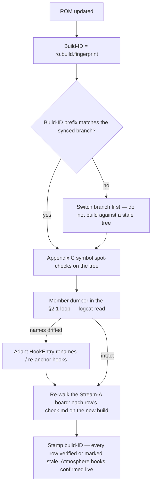
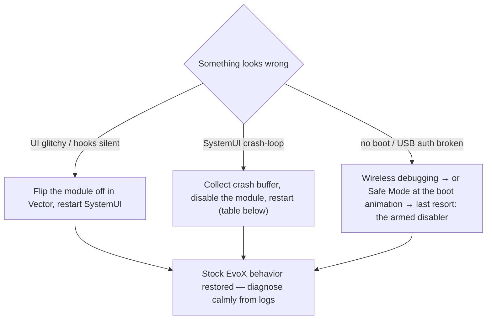

# Usage & Operations — Daily Workflow, Testing, Rescue

> Companion to the single source of truth: [`engineering_specification.md`](engineering_specification.md) (spec). This file covers *running the project day to day* — hot-reload loops, re-verification after ROM updates, the failure playbook, and the debug cheat sheet. The spec keeps the architecture, verified hook matrix, engine code, and risk register (spec §5–§13). First-time environment setup: [`./setup.md`](./setup.md). The project has **two work streams** with the same ops rules ([`architecture.md`](architecture.md) §2): **fixes** (things that annoy me in EvoX; captured in [`fix-registry.md`](fix-registry.md)) and **features** (Atmosphere + roadmap).

## 0. Mental Model

Three stages with increasing blast radius. Everything testable is **systemless** — partitions are never written (spec §1.5, R10) — so no stage can hard-brick; the only question is "how much UI do I lose, and for how long".

| Stage | What it changes on the device | Iteration speed | Blast radius if it breaks |
| --- | --- | --- | --- |
| **1 — Xposed live-patch** (Vector / LSPosed_mod + YukiHookAPI module) | Nothing persistent: an in-memory patch to the *running* `com.android.systemui` process + one user-space APK. Partitions and boot image untouched. | **~5 s hot loop**, no reboot (spec §0, §8.6) | Low. Worst case = SystemUI crash-loop black screen — UI unusable but rescued in seconds by the armed disabler or module toggle (R2). The device always boots. |
| **2 — native source integration** (engine + wiring in `frameworks/base`) | Still nothing on the device — it changes source on your build host only. | Iteration stays in Stage 1; Stage-2 changes ride a Stage-3 deploy (spec §9 → §11) | Zero while undeployed. Deployment risk = see Stage 3 (R1/R9). |
| **3 — incremental SystemUI build + signed systemless overlay** | One file: a custom-built `SystemUI.apk` mounted systemlessly by the Magisk/KernelSU module `evo_pong_systemui_test` (spec §11.3). **Zero partition writes.** | One `m SystemUI` build + redeploy + **reboot** per change (spec §11.1, §11.3) | Highest. A mis-signed APK can abort package scanning → SystemServer boot-no-go (R1); a branch-mismatched build can crash at boot (R9). Nothing on disk changed though — the disabler or Safe Mode reverts clean every time. |

Rule of thumb: **Stage 1 is the everyday lane** — it never builds a ROM, never flashes anything, never reboots per change. Stage 2/3 is the optional later ladder: go there only after the §3 re-verification, and only with §4's signing rule respected.

## 1. The Safety Shield — pre-flight ritual (do all four, every session)

Adapted from spec §4. Arm everything **before** the first SystemUI restart of the session, not after the first crash.

The damage model, stated honestly up front — nothing in the everyday loop can brick the device:

| What you do in this workbench | Boot risk | How you undo it |
| --- | --- | --- |
| Toggle the feature key via `adb` / Evolver | None | Instant — the key is read at runtime |
| Build + install the Stage-1 module, restart SystemUI | None | Flip the module off in Vector, or uninstall it |
| Experiment with the module enabled | Worst case is a SystemUI crash-loop | The failure playbook (§6) ends it in under a minute |
| Stage-3 systemless overlay (**deferred**) | Boot-loop possible | Pre-armed disabler + Safe Mode — and this lane stays empty until the ops §3/§4 gates pass |

No flashing, no partition writes, no slot switching (§4.1 systemless rule) — "bricked device" is not on the menu for Stream A/B work; the ritual below is anti-inconvenience, not anti-brick.

1. **Verify the active slot** (spec §4.1). The project is systemless-only — partitions are never written and slots are never switched — but know your starting point and keep the other slot bootable:

   ```bash
   adb reboot bootloader
   fastboot getvar current-slot
   # project rule (spec §4.1): if your daily setup is on slot a, keep it; test flashes only ever go systemless
   fastboot reboot   # back to Android — [VERIFY: exit-from-bootloader command is not in spec §4.1]
   ```

2. **Arm the bootloop disabler in a dedicated terminal window** (spec §4.2) — run it *before* touching SystemUI. It blocks silently until the device enumerates over USB, then force-removes **all** Magisk modules and reboots:

   ```bash
   adb wait-for-device shell su -c "magisk --remove-modules && reboot"
   ```

   - It nukes **every** Magisk module, not just ours — that is what makes it a guaranteed rescue, and what makes it a last resort.
   - **KernelSU** (spec §4.2): remove modules via recovery (`ksud module uninstall <id>`) or from the KernelSU manager while in Safe Mode.

3. **Hardware Safe Mode fallback** (spec §4.3): hold **Power + Volume Down** while the boot animation starts. Safe Mode disables all Magisk/KernelSU modules systemlessly and skips Xposed injection — **even when USB debugging is broken**. This is the rescue channel that survives a dead ADB.

4. **ADB redundancy** (spec §4.4): enable **Wireless debugging** in Developer options *before* testing — it rescues you when USB auth times out during a crash loop — and memorize the manual module-disable command for when the device is still reachable but SystemUI keeps crashing:

   ```bash
   adb shell su -c "mv /data/adb/modules/<module_id> /data/adb/modules/<module_id>.disabled && reboot"
   ```

   `<module_id>` = the id of the Magisk/KernelSU module to disable — the Vector/LSPosed framework package (kills Stage-1 injection) or the Stage-3 overlay (`evo_pong_systemui_test`). [VERIFY: the exact Vector / LSPosed_mod framework module id is not named in the spec — read it from that module's entry in your Magisk/KernelSU manager.]

Tip from spec §3: keep `scrcpy` running while debugging a crash loop so you can see what the device shows while you type blind.

**Pre-flight recital: slot known → disabler armed → Safe Mode known → wireless debugging on.** Missing any one of these means you are one crash-loop away from a recovery session instead of a one-command rescue (see §6).

## 2. Daily Stage-1 Loop

### 2.1 The hot-reload cycle (spec §8.6)

```bash
./gradlew assembleDebug && \
adb install -r app/build/outputs/apk/debug/app-debug.apk && \
adb shell su -c "pkill -f com.android.systemui"
```

Run from the module project root. The `&&` chain enforces order — never restart SystemUI before the new APK is installed.

### 2.2 What you should see

- The screen **blinks black ~1 s**, then the lockscreen reappears **with the new hook** (spec §8.6). That blink is normal; expect it every cycle.
- A black screen that does **not** return to the lockscreen is a crash, not the blink → go to §6 row 2.

### 2.3 Watching logs

```bash
# live window — engine + hook-framework tags
adb logcat | grep -E "EvoAtmo|YukiHook|Vector|LSPosed"

# after every SystemUI restart — crash buffer only
adb logcat -d -b crash | grep -i systemui
```

Recognizable lines — all by design, none emergencies on their own:

- `<hook name> NOT FOUND — run dumpMembers` → the anchor is missing on this build and the hook was never installed → re-verify per §3.
- `<hook> hook error: …` → per-hook fail-open: the hook fell back to `callOriginal()` instead of crashing SystemUI (spec §6.7).
- `AGSL compile failed, degrading to blur-only` → the runtime shader failed to compile on the vendor driver; blur-only fallback (R5).
- `Auto-tuned peakBlurRadius -> … (present=… ms)` → present-time auto-tune after unlock (spec §7): present > 22 ms → peak radius ×0.6, floored at 55.
- YukiHook debug output is on via `isDebug = true` (spec §8.3) — expect a chatty tag, not an error.

### 2.4 Two prototype flavors (spec §8.3 `MODE`)

| Flavor | Draws on | What you get | Start? | Watch out |
| --- | --- | --- | --- | --- |
| `MODE.VIEW_BLUR` | the Scrim view `mScrimBehind` via `setRenderEffect` | one-shot 650 ms blur pulse on the unlock trigger (V2); instant `RenderEffect(null)` cleanup on relock (V3) | **yes — start with this** | None of R3; cheapest, safest iteration |
| `MODE.WALLPAPER_MORPH` | the wallpaper `Surface`, owned by the engine's `HardwareRenderer` | full 720 ms morph (seed randomized per unlock), continuous scrub driver (V4), relock 1→0 at 450 ms | second | Needs the full `drawFrameOnCanvas` (V5) routing + `onSurfaceDestroyed` release, or you get dual-producer flicker/black wallpaper (R3) |

Switch flavor by editing `MODE` in `HookEntry`'s companion object (the checked-in default is `WALLPAPER_MORPH`; the code comment says start with `VIEW_BLUR` for your first run) → run §2.1 again.

### 2.5 Live toggle — no reinstall (spec §8.7)

```bash
adb shell settings put system nothing_atmosphere_unlock_enabled 1   # on (default)
adb shell settings put system nothing_atmosphere_unlock_enabled 0   # off → identical to stock; hooks no-op
```

Off means **no hook work at all** — that is exactly pass criterion #5 in the test plan below. The same key backs the Evolver switch later (spec §1, §9.5), so Stage 1 already has a working in-ROM toggle.

### 2.6 Optional: depth-effect cutout asset (spec §8.5, §10)

```bash
adb push subject_cutout.png /sdcard/
adb shell su -c "mkdir -p /data/data/dev.pong.evo.atmosphere/files && \
cp /sdcard/subject_cutout.png /data/data/dev.pong.evo.atmosphere/files/fg_subject.png"
```

The asset is a **pre-processed cutout PNG** (subject on transparency) from ML Kit subject segmentation or any editor with AI subject selection (spec §10). Depth is toggle-driven by `nothing_depth_foreground_enabled` (default `0`, spec §10).

### 2.7 Palette feed — make the mesh colors track your wallpaper (spec §8.4, §7)

Without a palette, `meshStrength` stays `0` and the shader skips the WallpaperColors-driven color-mesh blend (blur + UV warp/saturation still run — §7). The Stage-1 feed is an optional one-liner inside `loadApp`, after engine init (spec §8.4):

```kotlin
appContext?.let { ctx ->
    android.app.WallpaperManager.getInstance(ctx)
        .getWallpaperColors(android.app.WallpaperManager.FLAG_SYSTEM)
        ?.let { engine?.setWallpaperColors(it) }
}
```

In native Stage-2 the same feed runs at wallpaper-apply time instead (spec §9.4's `setWallpaperColors` snippet) — you should not need to call it manually there.

### 2.8 Hand-off checklist — when to leave Stage 1

Leave Stage 1 only when:

- every hook fires with zero `NOT FOUND` / `hook error:` lines across a few lock–unlock cycles (§3-verified anchors),
- the chosen flavor (§2.4) passes §5 checks 1–8 and toggles cleanly (§2.5),
- Perfetto shows the transition inside budget (§5 check 9).

Until then, every change belongs in the §2.1 loop — Stage-2/3 changes are real reboot-stake redeploys (§0, R1/R9).

### 2.9 While you're in there — capture annoyances (Stream A habit)

The Stage-1 module is not only a feature platform: a hook can **kill the things that annoy you in EvoX** (a Stage-1 workaround is often the fastest fix — `architecture.md` §2). So whenever something on the device irritates you, even in passing:

1. **Row first** — add one line to [`fix-registry.md`](fix-registry.md) (symptom + component *guess*). Ten seconds; no fixing now.
2. Fix later from the board, using the verify-first gate (§3, spec §9.6), the same hot-reload loop, and the same toggle/pattern rules as any engine change.
3. Bonus: a fix followed you here *because it annoyed me while testing the feature* — that's the point of the board.

## 3. After Every ROM Update

A ROM update will eventually rename hook members — old hooks go silent (R4). The whole re-verify is a fingerprint check, two greps, and one logcat read:

1. **Match fingerprint ↔ branch first** (spec §2.3, Appendix C #1) — the build-ID prefix `CN…` / `BK…` / `BP1A…` must equal the branch you sync (`cnb` / `bka` / `bp1a`):

   ```bash
   adb shell getprop ro.build.fingerprint
   ```

2. **Run the Appendix C symbol spot-checks** on your synced tree (verbatim from spec Appendix C):

   ```bash
   grep -n "onKeyguardFadingAwayChanged\|onKeyguardVisibilityChanged\|setTransitionToFullShadeProgress\|mScrimBehind" \
     frameworks/base/packages/SystemUI/src/com/android/systemui/statusbar/phone/ScrimController.java
   grep -n "drawFrameOnCanvas(\|class CanvasEngine" \
     frameworks/base/packages/SystemUI/src/com/android/systemui/wallpapers/ImageWallpaper.java
   grep -n "doKeyguardLocked" \
     frameworks/base/packages/SystemUI/src/com/android/systemui/keyguard/KeyguardViewMediator.java
   grep -rn "KeyguardClockSwitch\|class .*StatusView" frameworks/base/packages/SystemUI/src
   ```

3. **Runtime ground truth via the member dumper** (spec §8.3): uncomment `dumpMembers(SCRIM_CONTROLLER)` / `dumpMembers(IMAGE_WALLPAPER_ENGINE)` in `HookEntry`, run the §2.1 loop, then read:

   ```bash
   adb logcat -d | grep "EvoAtmo"    # dump lines list every actual field/method name on YOUR ROM build
   ```

**Expected outcome if names drifted:** the greps come back empty or hit renamed files, the dumper prints the full member list, and every stale hook logs `<name> NOT FOUND — run dumpMembers`. The feature is a **silent no-op**, not a crash — fail-open keeps SystemUI alive (R4); it shows up as "feature missing".

**Decision rule:** adapt the hook names in the module to what the dump reports (rename the `HookEntry` constants; if `ScrimController` dissolved entirely, re-anchor on `KeyguardStateController` — the preferred stable anchor V10). **Never blind-hook** — spec Appendix C: "blind hooking is the #1 source of wasted reboots". If the update also bumped Vector, re-validate module load via `logcat YukiHook/Vector` (R12).

**After the Atmosphere checks — re-run Stream A too.** Every non-stale row on [`fix-registry.md`](fix-registry.md) has the same exposure to member renames as the feature hooks: re-walk the board top-to-bottom, re-run each row's `check.md` scenarios on the new build, stamp `Build-ID last touched`, and mark rows `stale` whose evidence or patch no longer applies (their folders hold everything needed to re-triage). Patch-bearing findings (`fixes/FIX-*/patch/<old-branch>/`) additionally need their diffs re-applied against the next synced branch — that's exactly what the branch-named folders in `architecture.md` §3 are for.

The whole §3 as one flow:



## 4. Stage-2/3 Operational Notes

Condensed per-step minimums; follow each pointer for full detail.

1. **Version-match before any build** (spec §2.3, risk R9): the fingerprint's build-ID prefix must match your synced branch, otherwise `m SystemUI` builds against a different Android base than your ROM → crash-on-boot risk.
2. **Build only SystemUI** — no full OTA is needed to iterate (spec §11.1):

   ```bash
   source build/envsetup.sh
   lunch | grep -i pong            # select the target matching YOUR ROM's build-ID — never hardcode it
   m SystemUI -j$(nproc)
   ```

   Output: `out/target/product/Pong/system_ext/priv-app/SystemUI/SystemUI.apk` (spec §11.1).

3. **Signing is a requirement, not a nicety** (spec §11.2, R1): the overlay APK must be signed with the **same platform key your ROM was built with** — a key mismatch aborts package scanning at boot → SystemServer crash loop. **Never overlay onto an official Evolution X CI build** (signed with their keys); validate Stage-2 only inside a ROM you build yourself, or stay Stage-1-only. Signing is additive — overlay must be signed, never raw:

   ```bash
   java -jar out/host/linux-x86/framework/signapk.jar \
       build/target/product/security/platform.x509.pem \
       build/target/product/security/platform.pk8 \
       out/target/product/Pong/system_ext/priv-app/SystemUI/SystemUI.apk \
       /data/local/tmp/SystemUI-signed.apk
   ```

4. **Deploy systemless** (spec §11.3): push the signed APK to `/data/local/tmp/`, copy it into `/data/adb/modules/evo_pong_systemui_test/system/system_ext/priv-app/SystemUI/` (with `chmod 644`), write `module.prop` exactly as in spec §11.3's heredoc, then `adb reboot`. Zero partition writes (R10).
5. **Revert the overlay** (spec §16):

   ```bash
   adb shell su -c "mv /data/adb/modules/evo_pong_systemui_test /data/adb/modules/evo_pong_systemui_test.disabled && reboot"
   ```

6. **Post-boot verification** (spec §11.4):

   ```bash
   adb shell "dumpsys package com.android.systemui | grep -m1 -E 'versionName|pkgFlags'"   # your APK should be the one parsed
   adb logcat -d | grep -iE "EvoAtmo|AndroidRuntime.*systemui|PackageParser"               # expect no parser/runtime errors
   ```

   If the device never reaches the launcher: the §1 disabler or Safe Mode reverts the overlay — there is nothing on disk to undo (spec §11.4).

## 5. Test Plan

Run after every module change (Stage 1) and after every Stage-3 deploy. Rows 1–10 reproduce spec §15 verbatim in intent; rows 11–13 add recovery/UX angles consistent with the spec's facts.

| # | Scenario | Expected result | Pass criterion |
| --- | --- | --- | --- |
| 1 | Cold boot, module enabled | SystemUI loads; `EvoAtmo` logs appear | no `AndroidRuntime` crash entries (`-b crash`) |
| 2 | Lock → unlock (fingerprint) | morph 0→1, new seed each time (seeds logged) | settles to a sharp-ish home screen |
| 3 | Lock again | morph 1→0 | lockscreen wallpaper pixel-sharp |
| 4 | Swipe-dismissal scrub (MORPH mode) | blur/mesh tracks the finger | follows within ~2 frames; no rubber-banding |
| 5 | Toggle off: `settings put system nothing_atmosphere_unlock_enabled 0` | behavior identical to stock | no hook work at all (no per-unlock `EvoAtmo` logs) |
| 6 | AOD / screen off / power on | renderer released on screen-off (log) | rebinds cleanly on the next lockscreen |
| 7 | Change the wallpaper | palette feed updates | no stale seed artifacts |
| 8 | Fullscreen app → back home | wallpaper repaints correctly | surface-rebind path OK |
| 9 | Perfetto trace during tests 2–6 | transition inside budget | no >16.7 ms frame during the 720 ms transition at 120 Hz |
| 10 | Reboot with the Stage-3 overlay, then reboot again with the disabler armed | boots with your APK, then clean revert | `dumpsys package com.android.systemui` shows your APK; after the disabler, stock is restored |
| 11 | Fingerprint unlock vs. swipe-up unlock | both count as "every unlock" (spec §1; both paths hit the verified unlock trigger V2) | both fire; seed logged per unlock (the seed logging behind R11) |
| 12 | Toggle mid-animation (flip `…enabled` while the 720 ms transition runs) | fail-open holds (spec §6.7) | the in-flight transition completes; the **next** unlock respects the new state; `-b crash` stays empty |
| 13 | Cold reboot in airplane mode (no ADB available) | cold-start survival with no rescue channel: module persists, effect fires, launcher reachable | zero host interaction needed; if it doesn't come back, §1.3 Safe Mode is the only recourse — dry-running that path is the point |
| 14 | Atmosphere screen first run (spec §8.8) | first write attempt offers the stock "Modify system settings" grant; pre-grant the screen is read-only + hint | write works after the one-time grant, no root, no Vector coupling (reads never needed permission) |
| 15 | Wallpaper-adjacent listing (spec §8.8) | Settings → Wallpaper hub lists the Atmosphere entry; launcher icon opens it | entry opens the screen; `[VERIFY runtime]` whether Google's prebuilt long-press flow lists it — artifact to `assets/qa/<buildID>/` |
| 16 | Knob recipes (spec §8.8 keys) | each of the seven keys applies at the next transition (radius/durations/mesh/easing) | auto-tune floor still caps peak; settled stays clamped (R7); master-off = stock regardless of knobs |

## 6. Failure Playbook

**Escalation ladder as a chart** — every exit leads back to stock EvoX behavior, not to a recovery flash:



| Symptom | Immediate action | Root cause (risk ID) | Deeper rescue |
| --- | --- | --- | --- |
| Screen blinks black ~1 s after a SystemUI restart, lockscreen returns | none | expected hot-reload behavior (spec §8.6) | not a failure — keep iterating |
| Black screen that does **not** come back | check `logcat -d -b crash \| grep -i systemui`; if crashing, disable the module while reachable (§1.4) | R2 — SystemUI crash during hook development | armed disabler (§1.2) or Safe Mode (§1.3); then toggle off (`settings put … 0`) and bisect flavors per §2.4 |
| SystemUI crash-loop (endless black flashes, no stable UI) | manual module disable over Wireless debugging (§1.4) | R2 | `magisk --remove-modules` disabler (§1.2); KernelSU: remove via recovery / manager in Safe Mode (spec §4.2) |
| USB unreachable / auth dialog gone mid-loop | switch to Wireless debugging (armed in §1.4) | USB auth timeout during a crash loop — the exact case §4.4 covers | Safe Mode hardware combo (§1.3) works without USB at all; `scrcpy` (spec §3) keeps eyes on the UI while ADB still lives |
| Boot never completes after a Stage-3 deploy (stuck / SystemServer restart) | the §1.2 disabler fires the moment USB enumerates and reboots module-free | R1 (overlay signed with a different platform key) or R9 (built against a mismatched branch/build-ID) | Safe Mode (§1.3); permanent fix = platform-key signing (§11.2) + version-match (§2.3); never overlay an official CI ROM (§11.2). Nothing was on disk — clean revert (R10) |
| Effect never fires after a ROM update (no per-unlock logs) | run the §3 re-verify (Appendix C greps + `dumpMembers`) | R4 — hook members renamed; stale hooks log NOT FOUND and no-op | adapt hook names from the dump; if injection itself is gone, re-scope to `com.android.systemui` and check `logcat YukiHook/Vector` (R12) |
| Wallpaper flickers stock↔morphed or goes black around unlock | toggle off (`settings put … 0`) + restart SystemUI | R3 — two producers on the wallpaper Surface (stock `lockHardwareCanvas` vs our `HardwareRenderer`) | when ON, every frame must route through `drawFrameOnCanvas` (V5) and `onSurfaceDestroyed` must release engine resources (§6.3, §9.4) — one producer per Surface |
| Jank during the transition / battery drain | Perfetto trace; grep logs for `Auto-tuned peakBlurRadius` | R7 (persistent blur never settling) / R8 (hooks running during AOD/screen-off) | confirm settle-down to 28 px + one-shot present-time auto-tune (§7, §14) and the ACTION_SCREEN_OFF release (§8.3); battery historian for R8 |
| Morph is blur-only, no color-mesh; log shows `AGSL compile failed` | none required — by-design degradation | R5 — `RuntimeShader` failed to compile on the vendor driver | keep all-half arithmetic in the shader (§7); retest after future ROM/driver updates; don't force a fix |
| Morph runs but the color-mesh blobs never change with a new wallpaper | re-apply the palette feed (§2.7) and restart SystemUI | palette missing → `meshStrength = 0` skips the mesh mix (§7); also §5 check 7 | Stage-2: the feed runs at wallpaper-apply time (spec §9.4) — verify it actually executes after your wiring |
| My change doesn't show up after a hot-reload | confirm each `&&` link of §2.1 succeeded — a failed `assembleDebug`/`adb install -r` aborts the chain before SystemUI ever restarts; re-run the restart | workflow (§2.1), not a runtime risk | flip to `MODE.VIEW_BLUR` (§2.4) to isolate hooks from the engine; then check `-b crash` |
| "Flaky" regression captures — wallpaper differs every unlock | log `currentSeedX/Y/swirl` per unlock | R11 — seeds randomized by design | freeze seeds in a debug build for deterministic capture (spec R11 mitigation) |
| No `EvoAtmo` logs at all, even at cold boot | check module enabled and scoped to `com.android.systemui` only (§8.2) | R12 — Vector/LSPosed scope regression after a Vector update | validate load via `logcat YukiHook/Vector`; reinstall/re-enable the module; leave Safe Mode to confirm injection resumes |

Design-eliminated risks — know what should **never** appear: **R6**, no per-unlock `WallpaperManager.setBitmap()`: if you ever see per-unlock Monet recompute / ANRs, you reintroduced the removed v1 bake path (spec Appendix B, change 3). **R10**, the daily workflow contains no partition writes: anything suggesting `mount -o remount,rw /system_ext` is off-spec.

## 7. Command Cheat Sheet

Verbatim from spec §16, organized; includes the rescue disabler as the panic button.

**Restart & observe**

```bash
# Restart SystemUI without reboot
adb shell su -c "pkill -f com.android.systemui"      # or: killall com.android.systemui

# Watch module + engine logs (live; XposedBridge catches Yuki's low-level output too)
adb logcat | grep -E "EvoAtmo|YukiHook|Vector|LSPosed|XposedBridge"

# Crash history
adb logcat -d -b crash | grep -i systemui
```

**Runtime toggle** (same as §2.5)

```bash
# Toggle the feature live
adb shell settings put system nothing_atmosphere_unlock_enabled 1
adb shell settings put system nothing_atmosphere_unlock_enabled 0
```

**Disable a module / revert the overlay**

```bash
# Remove the Stage-3 overlay module
adb shell su -c "mv /data/adb/modules/evo_pong_systemui_test /data/adb/modules/evo_pong_systemui_test.disabled && reboot"

# Any Magisk module (e.g. the Stage-1 framework package) — spec §4 manual path
adb shell su -c "mv /data/adb/modules/<module_id> /data/adb/modules/<module_id>.disabled && reboot"
```

**Rescue disabler — the panic button** (armed in advance; waits for the device)

```bash
# Full nuke (when unreachable): §4 disabler command waits for the device automatically
adb wait-for-device shell su -c "magisk --remove-modules && reboot"
```

## Where to go next

- **Architecture, verified hook matrix, engine + hook code, risk register:** [`engineering_specification.md`](engineering_specification.md) — especially §4 (fail-safe setup), §8 (Stage 1), §11 (Stage 3), §13 (risks R1–R12), Appendix C (self-verification).
- **Environment setup (Linux host, SDK 36, Vector/YukiHookAPI, repo sync):** [`setup.md`](./setup.md).
- **The other half of the project:** feature backlog [`ideas.md`](./ideas.md) · annoyance board [`fix-registry.md`](fix-registry.md) · how it's all structured: [`architecture.md`](architecture.md).
