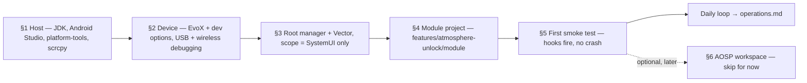

# Setup Guide — Environment, Device & Tooling

This replaces the spec's thin §3 *Environment & Tooling* with a workable path — **workstation → device prep → Vector/Xposed → Stage-1 module project → first smoke test → (Stage 2/3 only) AOSP workspace**. Every link, version and command below was re-verified on **2026-10-24** and carries a `[verified: …]` citation; anything unverifiable is marked `[VERIFY: …]` — resolve those before trusting the step. The spec (`engineering_specification.md`) remains the single source of truth for all engine/hook code; this guide only wires the environment around it.

## 0. Overview & Prerequisites

**Given as hard prerequisites** (not taught here — flashing is out of scope): the Nothing Phone (2) `Pong` has an **unlocked bootloader**, a bootable **Evolution X** install, and **root** via Magisk or KernelSU. The official device page carries downloads + flashing instructions [verified: https://evolution-x.org/device/Pong — 2026-10-24].

| Needs to exist… | Requirement | One-line purpose |
| --- | --- | --- |
| Host workstation | Linux or macOS host (Linux **mandatory** for Stage 2/3, ≥ 32 GB RAM) | Spec §3 sizes the full source sync for Stage 2/3 only |
| Host workstation | JDK 17 or newer | YukiHookAPI ≥ 1.2.0 requires Java 17+ (1.2.1-era docs, cited in §4) |
| Host workstation | Android Studio + Android SDK (SDK 36 module project) | Stage-1 compile target per spec §3 |
| Host workstation | `platform-tools` (`adb` / `fastboot`) on PATH | Installs, SystemUI restarts, version probes |
| Host workstation | scrcpy | Screen mirror so a SystemUI crash loop stays debuggable |
| Host workstation | Perfetto (optional) | Jank tracing [spec §3/§17 — verified: https://perfetto.dev — 2026-10-24] |
| On-device | Evolution X + root (Magisk/KernelSU) with **Zygisk** enabled | Vector injects through the Zygisk loader |
| On-device | **Vector** (JingMatrix) Xposed framework, installed and scoped | Loads and manages our hook module |
| On-device | Developer options + USB + Wireless debugging | adb, plus a rescue channel when USB auth breaks mid-crash-loop |
| On-device | Stage-1 module APK (built in §4) | The actual hook carrier |



## 1. Host Workstation Setup

Works on **macOS** and **Linux** alike; OS-specific bits are called out inline. Stage 2/3 later requires Linux (spec §3).

### 1.1 JDK 17+

The 1.2.1-era YukiHookAPI docs require **Java 17+ since API 1.2.0** (Java 11 was dropped at 1.2.0) [verified: https://web.archive.org/web/20250420005658/https://highcapable.github.io/YukiHookAPI/en/guide/quick-start — 2026-10-24]. Check what you have:

```bash
java -version   # must report 17.0.x or newer
```

`[VERIFY: exact install command for a recent JDK on your distro/OS — e.g. a Temurin build via your package manager; not documented verbatim on any page fetched for this guide]`

### 1.2 Android Studio + SDK + platform-tools

Install Android Studio from the official page (carried by spec §17) [verified: https://developer.android.com/studio — 2026-10-24], and through its SDK manager install **SDK 36** — spec §3 fixes 36 as the Stage-1 module SDK (Android 16 = API 36 confirmed on the official dev-options page [verified: https://developer.android.com/studio/debug/dev-options — 2026-10-24]).

`adb`/`fastboot` live in the SDK's `platform-tools`. On **macOS** they can also come from Homebrew (the scrcpy project's documented macOS adb source) [verified: https://github.com/Genymobile/scrcpy/blob/master/doc/macos.md — 2026-10-24]; on **Linux** adb is a distro package (the scrcpy Linux doc verifiably apt-installs `adb` on Debian/Ubuntu) [verified: https://github.com/Genymobile/scrcpy/blob/master/doc/linux.md — 2026-10-24]:

```bash
# macOS (Homebrew, https://brew.sh):
brew install --cask android-platform-tools    # adb + fastboot without Studio

# Debian/Ubuntu (verified via the scrcpy Linux doc):
sudo apt install adb
# Fedora/Arch: same tools, other names —
# [VERIFY: your distro's adb/fastboot package name, e.g. android-tools]
```

Put the SDK on your PATH:

```bash
# add to ~/.zshrc (macOS + Linux):
export ANDROID_HOME="$HOME/Library/Android/sdk"   # macOS Studio default
# export ANDROID_HOME="$HOME/Android/Sdk"         # Linux Studio default
export PATH="$PATH:$ANDROID_HOME/platform-tools"  # adb + fastboot
```

`[VERIFY: if the SDK was installed elsewhere adjust ANDROID_HOME; those two default paths were not documented on a fetched page]`

Verify the toolchain (expected output: version lines for each tool):

```bash
adb version          # "Android Debug Bridge version …" — any modern build is fine
fastboot --version   # fastboot from the same platform-tools
adb devices          # exercised for real in §2
```

### 1.3 scrcpy (device screen on your monitor)

scrcpy needs USB debugging (§2) and Android ≥ 5.0; it mirrors and controls the device from the host [verified: https://github.com/Genymobile/scrcpy — 2026-10-24]. Install (commands verbatim from the project's per-OS docs, including their "obsolete package" warnings for Debian/Snap):

```bash
# macOS:
brew install scrcpy            # verified: scrcpy doc/macos.md

# Linux distro packages (verified: scrcpy doc/linux.md):
sudo apt install scrcpy        # Debian/Ubuntu — flagged *obsolete version* there; prefer the release below
pacman -S scrcpy               # Arch Linux
dnf copr enable zeno/scrcpy && dnf install scrcpy   # Fedora
emerge scrcpy                  # Gentoo

# Linux/macOS current static build (verified: same docs):
# download scrcpy-*-v5.0.1.tar.gz from https://github.com/Genymobile/scrcpy/releases/latest, extract
```

```bash
scrcpy              # mirror; right-click = BACK, middle-click = HOME (docs)
scrcpy --version    # sanity check without a device
```

## 2. Device Prep

Assumed true before this section: **bootloader unlocked · Evolution X flashed · rooted with Magisk or KernelSU (Zygisk-capable)** — spec §3's baseline. For orientation, the device page currently ships Android 16 official builds (Evolution X 11.11, 2026-09-15 shown at verification) [verified: https://evolution-x.org/device/Pong — 2026-10-24].

### 2.1 Developer options, USB debugging, Wireless debugging

Procedure per Google's developer-options page [verified: https://developer.android.com/studio/debug/dev-options — 2026-10-24]:

1. Find **Build number** in Settings (Android 9+ phones: **Settings → About phone → Build number**) and tap it **seven times** until *"You are now a developer!"* appears. `[VERIFY: on Evolution X the tap-item may be the ROM's version entry rather than stock "Build number" — check your EvoX Settings' About page]`
2. Return one level; **Developer options** now exists (Android 9+: under **System**).
3. Toggle **USB debugging** — documented Android 9+ path: *Settings → System → Advanced → Developer Options → USB debugging* [same verified page].
4. Toggle **Wireless debugging** — documented Android 16 (API 36)+ path: *Settings → System → Developer options → Wireless debugging*; pair from its own dialog [same verified page]. Keep it ON: spec §4 item 4 uses wireless adb as the crash-loop rescue channel.
5. (Optional) **Stay awake** in Developer options keeps the screen on while plugged in [same verified page].

### 2.2 First host↔device handshake

```bash
adb devices    # first connection → accept the RSA prompt ON the phone
# List of devices attached
# <serial>    device      <- "unauthorized" means: accept the dialog on the phone
```

Version probes used by spec §2.3 (and §6 here) should now work:

```bash
adb shell getprop ro.build.version.release   # e.g. 16
adb shell getprop ro.build.fingerprint       # embeds the build-ID used in §6
```

## 3. Root Manager + Vector (Xposed framework)

Spec §3 fixes the stack: **Vector (JingMatrix)** as the Xposed framework, its fallback being `mywalkb/LSPosed_mod` [spec §3/§17]. Vector is a Zygisk module providing an ART hooking framework with API consistency to the classic Xposed API, built on LSPlant; its README states it **"supports devices running Android 8.1 through Android 17 Beta"** — the basis for the spec's "Vector supports Android 8.1 → 17" claim [verified: https://github.com/JingMatrix/Vector — 2026-10-24].

Install (steps per the README [verified: https://github.com/JingMatrix/Vector — 2026-10-24]):

1. Ensure a **Zygisk environment exists** — the README requires "a recent installation of Magisk or KernelSU with Zygisk enabled"; where stock Zygisk is absent it names **NeoZygisk** (`https://github.com/JingMatrix/NeoZygisk`) as an example provider.
2. Download the latest **release zip** from <https://github.com/JingMatrix/Vector/releases> (stable channel; CI "canary" builds exist on GitHub Actions but need a GitHub login, and the README recommends **debug builds when troubleshooting**).
3. Install the zip **via the root manager** (Magisk app: Modules → Install from storage; KernelSU: its module installer) — i.e. the standard Magisk-module flow: download zip → install via Magisk app → reboot.
4. **Reboot**.
5. Open the manager **via the system notification** posted after boot (a manager app also exists on the device).

Then set the **scope** — a spec requirement (§8.2), not a nicety:

- In the Vector manager, enable the project module with scope **`com.android.systemui` only** — literally no other package (spec risk R12: scope regressions are a known Vector-update failure mode). Note the spec's optional manifest meta-data `xposedscope = com.android.systemui` pre-ticks that scope in managers (written in §4.3 below).

**Fallback framework:** if Vector won't inject on your ROM build, `mywalkb/LSPosed_mod` (<https://github.com/mywalkb/LSPosed_mod> — the classic-UI community LSPosed fork, spec §17) installs through the *same* zip → root-manager → reboot → enable-in-manager flow with the identical module APK [spec §3/§17 — existence and role].

Sanity check after that reboot:

```bash
adb logcat -d | grep -iE "vector|lsposed"
# ^ expect framework load lines (and, after §4, lines showing your module being loaded)
```

## 4. Stage-1 Module Project

**Read first — the hooking API was renamed upstream.** `YukiHookAPI` is now **YukiHook** (repo `HighCapable/YukiHook`; the old docs host `highcapable.github.io/YukiHookAPI/…` is gone) and current docs describe a restructured project — split `yukihook-core` / `yukihook-compiler` / `yukihook-runtime-*` artifacts with new entry annotations such as `@YukiHookXposed82Entry` [verified: https://github.com/HighCapable/YukiHook — 2026-10-24] [verified: https://highcapable.github.io/YukiHook/en/guide/quick-start.html — 2026-10-24] [verified: https://highcapable.github.io/YukiHook/en/library/yukihook-compiler.html — 2026-10-24]. **This project pins the classic 1.x API anyway**: spec §8.1 uses `com.highcapable.yukihookapi:api:1.2.1`, which Maven Central still lists as the latest published version of those coordinates [verified: https://search.maven.org/solrsearch/select?q=g:%22com.highcapable.yukihookapi%22 — 2026-10-24]. So use the spec's 1.2.1 code (`@InjectYukiHookWithXposed` / `IYukiHookXposedInit`) and do **not** copy entry snippets from the current renamed docs. The 1.x-era documentation below was recovered from Wayback captures of the original docs: [verified: https://web.archive.org/web/20250420005658/https://highcapable.github.io/YukiHookAPI/en/guide/quick-start — 2026-10-24] [verified: https://web.archive.org/web/20250414151510/https://highcapable.github.io/YukiHookAPI/en/config/xposed-using — 2026-10-24] [verified: https://web.archive.org/web/20250413140917/https://highcapable.github.io/YukiHookAPI/en/config/api-example — 2026-10-24].

### 4.1 Create the project

**Where it lives:** `features/atmosphere-unlock/module/` in **this repo** (workbench layout — `architecture.md` §3). **Already created** — scaffold commit `9df8fb6` (2026-10-24) includes the full Gradle project + wrapper 8.11.1; skip the New Project wizard and just open the `module/` folder in Android Studio (§1.2) and let it sync. Settings already baked in — verify them after the first sync:

- Kotlin; **minSdk 30** — the classic-Xposed floor is low (xposed82 runtime minSdk 21 [verified: https://highcapable.github.io/YukiHook/en/guide/quick-start.html — 2026-10-24]), but on this device we use API 30+.
- **Package / applicationId / namespace: `dev.pong.evo.atmosphere`** (spec §8.1).
- **Compile/target SDK 36** (spec §3); `buildFeatures.buildConfig = true` (required on AGP 8+); Gradle JDK 17.

### 4.2 Module `app/build.gradle.kts`

Shape verified against the 1.2.1-era docs (Wayback quick-start + xposed-using captures); only concrete version pins remain open (see markers):

```kotlin
// plugins: app + Kotlin + KSP (KSP runs the api/ksp-xposed processor; required as an Xposed module)
plugins {
    id("com.android.application")
    id("org.jetbrains.kotlin.android")
    id("com.google.devtools.ksp")   // version must match your Kotlin version (verify below)
}
// CHOSEN PIN SET (provisional — recorded in gradle/libs.versions.toml): AGP 8.9.2 / Gradle 8.11.1 /
// Kotlin 1.9.24 / KSP 1.9.24-1.0.20, satisfying the 1.2.1-era documented minimums (Kotlin 1.7.0+,
// AGP 7.0+, Gradle 7.0+, Java 17+ since API 1.2.0) and compileSdk 36.
// [VERIFY: confirm the set with a successful sync + build, then move this note to a [verified: …]]

android {
    namespace = "dev.pong.evo.atmosphere"
    compileSdk = 36                        // spec §3
    buildFeatures { buildConfig = true }   // REQUIRED on AGP 8+ (verified, xposed-using capture)

    compileOptions {
        sourceCompatibility = JavaVersion.VERSION_17   // Java 17+ required since API 1.2.0
        targetCompatibility = JavaVersion.VERSION_17
    }
    kotlinOptions { jvmTarget = "17" }
}

// =====================================================================
// Dependency block — SPEC §8.1, PRESERVED VERBATIM (YukiHookAPI 1.2.1 is
// the latest version published on Maven — verified 2026-10-24). NO EDITS.
// =====================================================================
dependencies {
    compileOnly("de.robv.android.xposed:api:82")
    implementation("com.highcapable.yukihookapi:api:1.2.1")
    ksp("com.highcapable.yukihookapi:ksp-xposed:1.2.1")
}
```

Repositories (project-level), per the 1.x-era docs: [verified: Wayback quick-start capture — 2026-10-24]; the content-filter form is verified in the current docs too:

```kotlin
repositories {
    google()
    mavenCentral()
    // REQUIRED as an Xposed module — serves de.robv.android.xposed:api:82.
    // The originally-documented official repo https://api.xposed.info/ is DEAD as of
    // 2026-10-25 (DNS resolves to an unrelated IP; connections time out) — the artifact
    // (pom+jar verified) currently lives on the public Appodeal Artifactory mirror that
    // mvnrepository lists for this exact coordinate.
    maven("https://artifactory.appodeal.com/appodeal-public/") {
        content { includeGroup("de.robv.android.xposed") }
    }
    // REQUIRED — YukiHookAPI 1.2.1 transitively pulls com.github.tiann:FreeReflection,
    // published only on JitPack [verified: first on-disk resolution failure — 2026-10-25].
    maven("https://jitpack.io") {
        content { includeGroup("com.github.tiann") }
    }
    // Optional fallbacks the docs list:
    // maven("https://s01.oss.sonatype.org/content/repositories/releases/")   // 1.x-era backup
    // maven("https://raw.githubusercontent.com/HighCapable/maven-repository/main/repository/releases")   // current backup
}
// CRITICAL (verified): api and ksp-xposed versions must match one-to-one.
```

**Further deltas proven by the first real build of the module (2026-10-25, assembleDebug green on this exact set):**

- Add `implementation("androidx.annotation:annotation:1.9.1")` — YukiHookAPI's `api` artifact keeps its own AndroidX deps `compileOnly`, and its KSP processor emits `androidx.annotation.Keep` into the generated sources; without this pin the annotation is unresolved [verified: compiler error → fix → green].
- Set `android.useAndroidX=true` in `gradle.properties` — the Yuki `api` artifact carries AndroidX transitive dependencies (appcompat, preference-ktx), and `checkDebugAarMetadata` fails without it [verified: AGP error → fix → green].
- Pin `buildToolsVersion = "36.0.0"` in the `android {}` block — the Nix-flake dev SDK (flake.nix) ships build-tools 36.0.0 only, and AGP's default (35.0.0) cannot be self-installed into the read-only store [verified: SDK install failure → pin → green].
- `minSdk`/`targetSdk` must sit inside `defaultConfig {}` (not directly in `android {}`) — the bootstrap draft had them at the wrong level and the build script itself failed to compile [verified: KtDSL unresolved-reference → fix → green].

KSP plugin wiring (`id("com.google.devtools.ksp") version "<ksp-version>"`, matching the KSP release to your Kotlin from <https://github.com/google/ksp/releases>) is documented in both the 1.x-era and current docs [verified: Wayback quick-start capture — 2026-10-24] [verified: https://highcapable.github.io/YukiHook/en/library/yukihook-compiler.html — 2026-10-24].

`[VERIFY: whether a Gradle DSL extension such as `yukihookapi { isXposedModule = true … }` exists for 1.2.1 — the 1.2.1-era docs configure module-ness via manifest meta-data + the entry annotation only; no such extension appears there, so don't add one on an unverified hunch]`

### 4.3 `AndroidManifest.xml` meta-data

Inside `<application>` [verified: https://web.archive.org/web/20250420005658/https://highcapable.github.io/YukiHookAPI/en/guide/quick-start — 2026-10-24; `xposedscope` from spec §8.2]:

```xml
<!-- Set as Xposed module -->
<meta-data android:name="xposedmodule" android:value="true" />
<!-- Your module description -->
<meta-data android:name="xposeddescription"
    android:value="Nothing Atmosphere unlock effect — Evolution X (Pong)" />
<!-- Minimum Xposed API (the 1.x docs recommend 93 for LSPosed-family managers) -->
<meta-data android:name="xposedminversion" android:value="93" />
<!-- Optional: pre-select the SystemUI scope in managers (spec §8.2) -->
<meta-data android:name="xposedscope" android:value="com.android.systemui" />
```

### 4.4 Copy the code from the spec — nothing else

Do **not** re-paste engine/hook code here; it lives in the spec:

| File | Source in spec | Destination in this project |
| --- | --- | --- |
| `NothingAtmosphereEngine.kt` | spec **§7** | `app/src/main/java/com/android/systemui/nothing/atmosphere/NothingAtmosphereEngine.kt` |
| `HookEntry.kt` | spec **§8.3** | `app/src/main/java/dev/pong/evo/atmosphere/hook/HookEntry.kt` |

Notes while copying:

- Keep the engine's package `com.android.systemui.nothing.atmosphere` exactly as-is — spec §9.1 reuses that package in Stage 2; and `HookEntry.kt` stays in `dev.pong.evo.atmosphere.hook` (spec §8.3). Only the module's *namespace/applicationId* is `dev.pong.evo.atmosphere`.
- **Engine copy convention:** for first bring-up this direct copy inside `module/` is correct. Later, the canonical engine copy is promoted to `features/atmosphere-unlock/engine/` and shared into the module via Gradle source-sets (exact wiring verified then — `architecture.md` §3/§4). Don't invent the wiring now; don't dual-maintain copies either — promote once, wire once, delete the module's private copy in the same commit.
- Spec §7's post-block note requires the `android.os.Handler` / `android.os.Looper` imports in-file — confirm they survive the copy.
- Optional Stage-1 extras come later from the spec itself: palette feed one-liner (§8.4), depth cutout push (§8.5). No setup action now.

### 4.5 What the compiler generates — nothing hand-written

Verified behavior of `@InjectYukiHookWithXposed` [verified: https://web.archive.org/web/20250414151510/https://highcapable.github.io/YukiHookAPI/en/config/xposed-using — 2026-10-24]:

- The annotated class must implement `IYukiHookXposedInit`; **only one** annotated entry per project (compile error otherwise).
- `modulePackageName` / `sourcePath` default sensibly (namespace-derived / `src/main`) — leave defaults; never fill `BuildConfig.APPLICATION_ID` into the annotation (documented trap).
- Each build generates **`assets/xposed_init`** + **`resources/META-INF/yukihookapi_init`** and the `<Entry>_YukiHookXposedInit` entry class. Never hand-write them; gitignore both as the docs suggest. (The current renamed compiler likewise treats manual entry/config files in the source dir as an error [verified: https://highcapable.github.io/YukiHook/en/library/yukihook-compiler.html — 2026-10-24].)

### 4.6 Build it

```bash
./gradlew assembleDebug   # watch the KSP task emit the generated Xposed entry
```

If `de.robv.android.xposed:api:82` won't resolve, re-check §4.2's repository list; if KSP complains of a mismatched processor, `api`/`ksp-xposed` versions diverged (both must be `1.2.1` — verified one-to-one rule).

## 5. First Smoke Test

Spec §8.6's hot-reload loop, verbatim — install and restart SystemUI, no reboot:

```bash
./gradlew assembleDebug && \
adb install -r app/build/outputs/apk/debug/app-debug.apk && \
adb shell su -c "pkill -f com.android.systemui"
```

Expected: the screen blinks black ~1 s, the lockscreen returns with hooks attached (spec §8.6). Logs:

```bash
# module + engine + framework chatter (spec §8.6/§16 grep set)
adb logcat -d | grep -E "EvoAtmo|YukiHook|Vector|LSPosed"

# crash history after every SystemUI restart (spec §8.6)
adb logcat -d -b crash | grep systemui
```

**Pass criteria** (no screenshots needed):

1. UI recovers to a working lockscreen after the restart.
2. The first grep shows framework-side load lines (Vector/LSPosed) plus module-side `EvoAtmo` lines (the TAG of `HookEntry`, spec §8.3) and/or YukiHook lines.
3. **No `… NOT FOUND — run dumpMembers` lines** → `onKeyguardFadingAwayChanged`, `onKeyguardVisibilityChanged`, `setTransitionToFullShadeProgress`, `drawFrameOnCanvas` all resolved on your ROM.
4. Lock → unlock (fingerprint) plays the blur/mesh morph; locking again returns a pixel-sharp wallpaper (mirrors spec §15 items 2–3).
5. `adb logcat -d -b crash | grep systemui` is **empty**.
6. Kill-switch without reinstall: `adb shell settings put system nothing_atmosphere_unlock_enabled 0` → stock behavior; `… 1` → effect back [spec §8.7, verbatim commands].

From here on, §8.6 *is* the 5-second iteration loop: edit → rebuild → reinstall → `pkill`. Operational usage (daily loop, tracing, toggling) — and troubleshooting — live in `operations.md`.

## 6. AOSP Workspace (Stage 2/3 only)

**Skip until Stage 1 works.** A full sync is only for porting natively (Stage 2) or building/flashing SystemUI yourself (Stage 3): spec §3 sizes it as a **Linux host with ≥ 32 GB RAM**, plus a fast SSD with generous free space `[VERIFY: disk-space figure is not stated in the spec — resolve against the official build docs before syncing]`.

Before syncing, run spec §2.3's **version-match procedure** on the device:

```bash
adb shell getprop ro.build.version.release   # Android level of YOUR ROM
adb shell getprop ro.build.fingerprint       # contains the build-ID, e.g. CN… / BK… / BP1A…
```

Rule (spec §2.3): the **first two letters of the build-ID must match the source branch** you sync — `cnb → CN…`, `bka → BK…`; legacy `bp1a → BP1A…` is stale unless your ROM is literally that build. Official Evolution X for Pong currently ships Android 16 builds [verified: https://evolution-x.org/device/Pong — 2026-10-24]; when unsure, check that page's release notes, the Telegram archive <https://t.me/s/NothingPhone2updates> [spec §2.1], and ask the maintainer which branch matches.

Source anchors (all verified present):

| What | Where |
| --- | --- |
| Evolution X org (frameworks, apps, everything else) | <https://github.com/Evolution-X> |
| `frameworks_base` (hook-point home; branches `cnb` / `bka` / legacy) | <https://github.com/Evolution-X/frameworks_base> [spec §2.2] |
| Pong device tree (default branch `bka`) — `DeviceExtras/`, `nothing-fwk/`, `vibrator/`, `lineage_Pong.mk`, **`evolution.dependencies`** | <https://github.com/Evolution-X-Devices/device_nothing_Pong> |
| The Evolver (Stage-2 toggle target, spec §9.5) | <https://github.com/Evolution-X/packages_apps_Evolver> |

Installing the `repo` tool and running `repo init` belong to Evolution X's official build instructions:

`[VERIFY: exact "repo init" manifest URL / init command from Evolution X's official build instructions — start from the device page https://evolution-x.org/device/Pong and the Evolution X wiki it advertises in its navigation (https://wiki.evolution-x.org), or the device's XDA thread; no build manifest was reachable/documentable during 2026-10-24 verification]`

`[VERIFY: how `evolution.dependencies` in the device tree is consumed by the Evolution X build flow (the file's presence is verified in the `bka` tree; the procedure that reads it was not covered by any fetched page or the spec)]`

After sync, **don't trust hook names on paper**: run spec Appendix C's grep spot-checks against your parent tree, then cross-check with the Stage-1 module's runtime dumper (`dumpMembers`, spec §8.3) for ground truth on your build.

Stage 3's build then follows spec §11; the `lunch` target is **never hardcoded** — take it from your synced tree (spec §2.3):

```bash
source build/envsetup.sh
lunch | grep -i pong    # choose the line matching YOUR ROM's build-ID letters
m SystemUI -j$(nproc)   # spec §11.1 — output under out/target/product/Pong/…
```

(Stage-3 signing + systemless overlay rules, spec §11.2/§11.3, apply before any flash.)

## 7. Post-Setup Checklist

Work top-down; §0–§5 together are the Stage-1 readiness bar.

- [ ] JDK 17+ answers `java -version` (§1.1)
- [ ] `platform-tools` on PATH; `adb version` + `fastboot --version` OK (§1.2)
- [ ] scrcpy installed and mirrors the device (§1.3)
- [ ] Bootloader unlocked · Evolution X + root present (given prerequisite, not produced here) (§2)
- [ ] Developer options + USB debugging + Wireless debugging enabled; `adb devices` shows `device`, not `unauthorized` (§2)
- [ ] Zygisk environment confirmed in the root manager (§3)
- [ ] Vector zip installed via root manager; device rebooted; manager reachable via its notification (§3)
- [ ] Vector manager: module scope = `com.android.systemui` **only** (§3)
- [ ] Project created: namespace `dev.pong.evo.atmosphere`, compileSdk 36, Java 17, `buildConfig = true` (§4)
- [ ] Spec §8.1 dependency block verbatim (1.2.1) + KSP plugin wired (§4)
- [ ] Engine (§7) + HookEntry (§8.3) copied to the exact paths; manifest meta-data (incl. `xposedscope`) in place (§4)
- [ ] `assets/xposed_init` / `META-INF/yukihookapi_init` generated by KSP — never hand-written, gitignored (§4)
- [ ] `./gradlew assembleDebug` green; §5 pass criteria all true (§5)

*(Stage 2/3 only)* Linux ≥ 32 GB host ready; branch ↔ build-ID matched; sync initiated from the official manifest — §6.

---

Operational usage (build/deploy loop, toggling, tracing) — and troubleshooting — lives in [`operations.md`](./operations.md).
